<p align="center">
  <picture>
    <source media="(prefers-color-scheme: dark)" srcset="docs/screenshots/logo-dark.png">
    
  </picture>
</p>

<p align="center"><strong>Your charging spot, kept free.</strong></p>

<p align="center">
Baywatch lets EV drivers book a public charger for a time slot, or take one right now with <strong>Book now</strong>.<br>
At a Baywatch bay, a real Ecurious lock keeps the bay free until you arrive, and its camera lowers the arm for your plate only.<br>
Operators get blocked-bay alerts and a dashboard, and other charging apps can book through our OCPI-style API.
</p>

<p align="center">
  <a href="baywatch_demo_90s.mp4"><strong>▶ Watch the 90-second demo</strong></a>
  &nbsp;·&nbsp;
  <a href="https://app.notion.com/p/BayWatch-4032e6d9e3bb8033b730de17ef7f7b33?source=copy_link">Project board</a>
  &nbsp;·&nbsp;
  Built for the Ecurious challenge at Watt the Hack
</p>

<p align="center">
  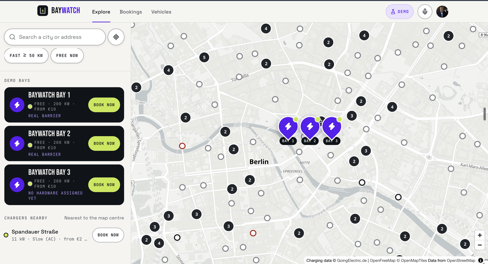
</p>
<p align="center">
  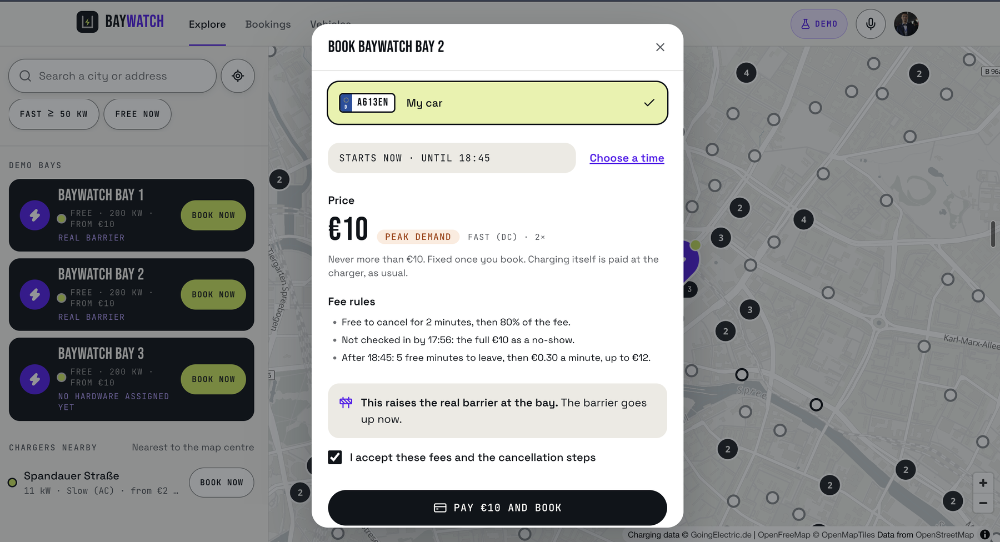
  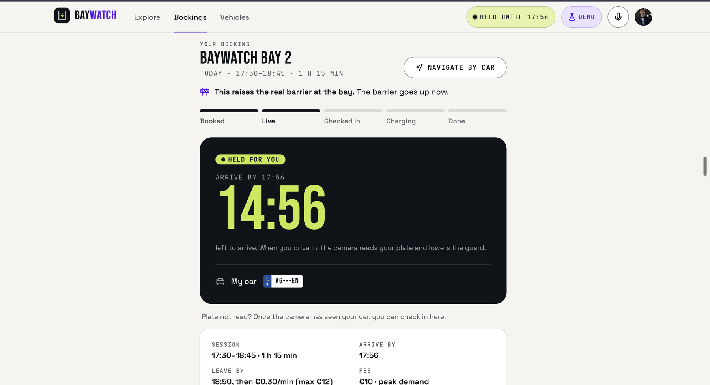
</p>
<p align="center"><sub><strong>Explore</strong> every charger, <strong>Book now</strong> (shown at peak demand, the €10 cap), and the bay <strong>held for you</strong> until you arrive. Screenshots of the running app.</sub></p>

<p align="center">
  <a href="baywatch_demo_90s.mp4">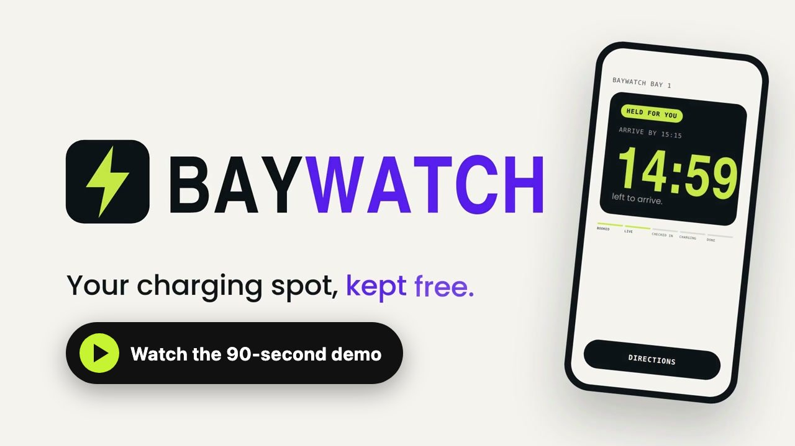</a>
</p>

<details>
<summary><strong>More screens</strong>: the landing page and scenes from the demo video</summary>

<p align="center">
  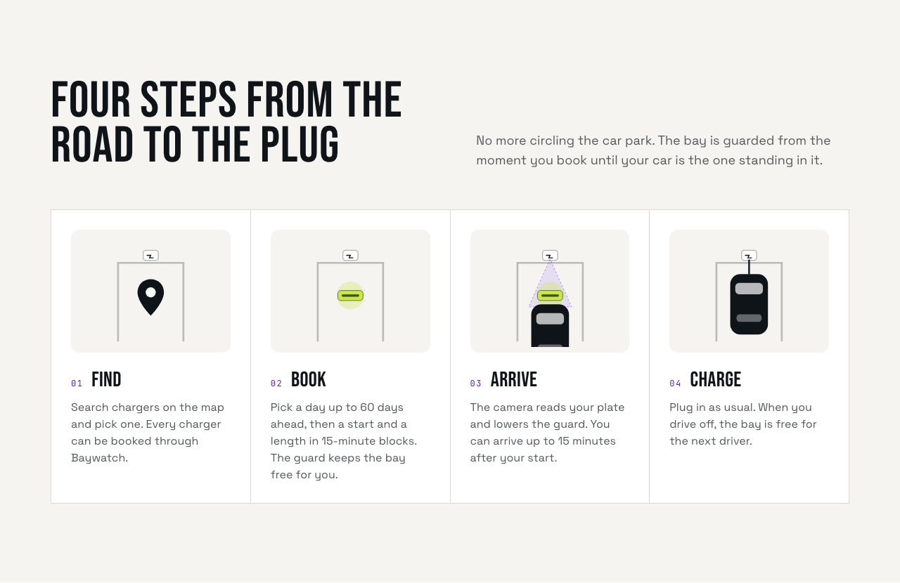
  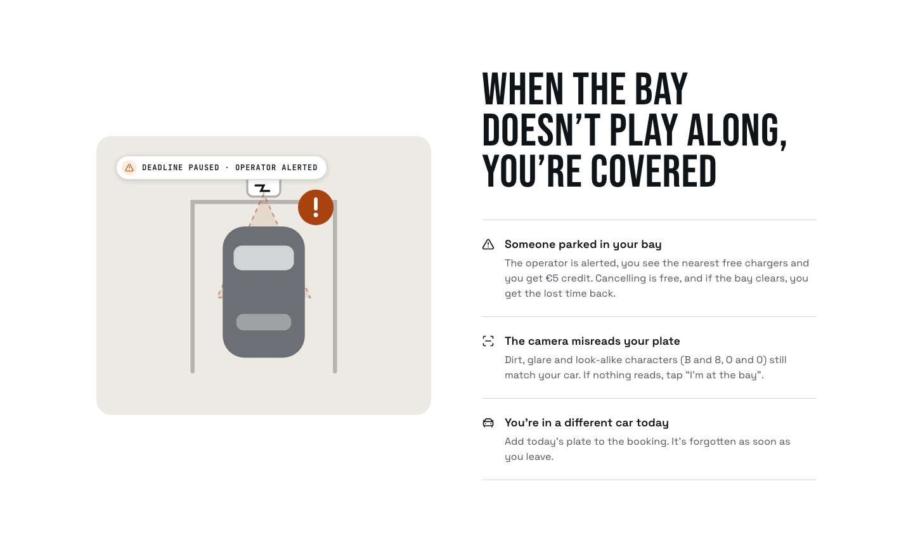
</p>
<p align="center">
  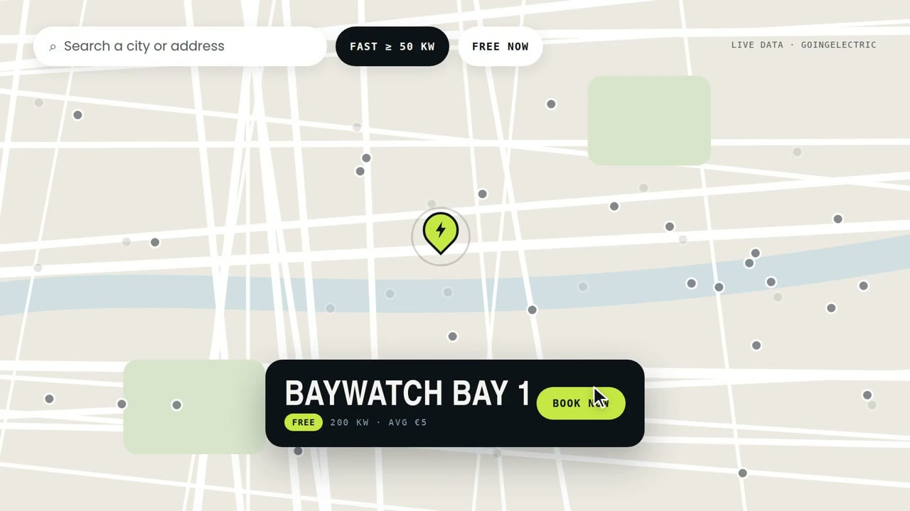
  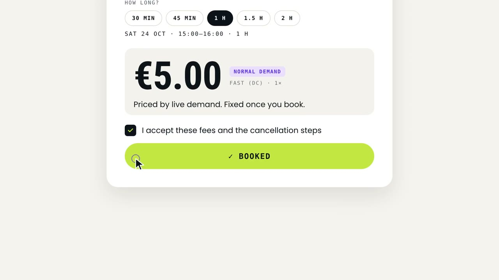
</p>
<p align="center">
  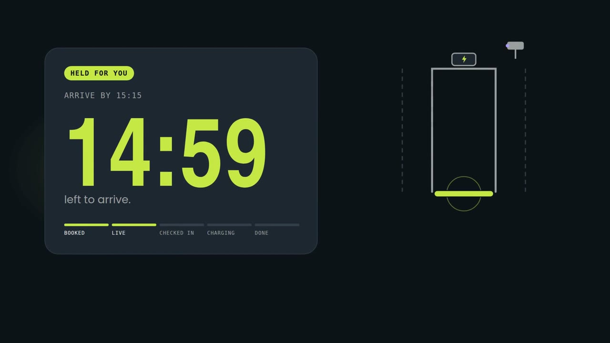
  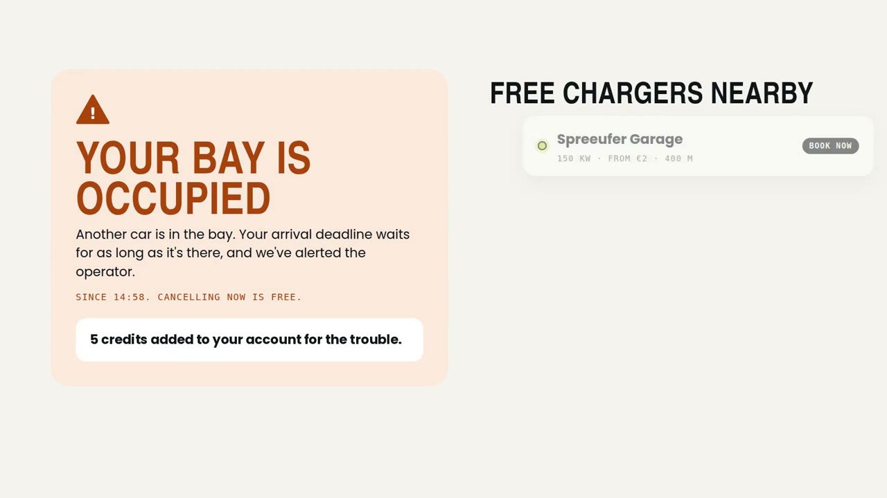
</p>
<p align="center">
  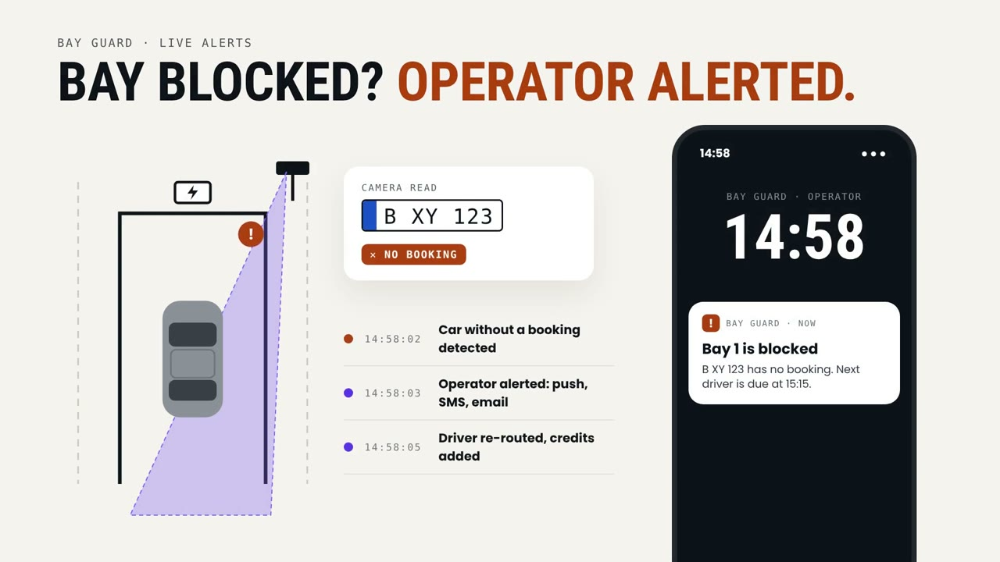
  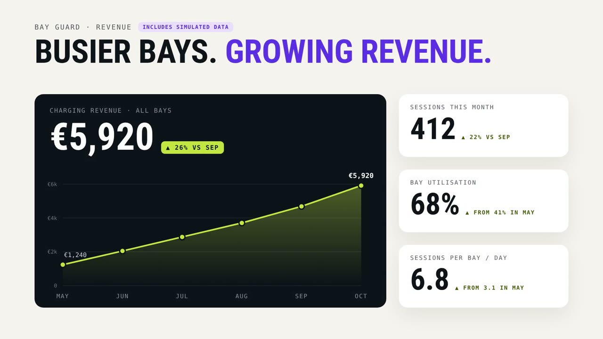
</p>
<p align="center">
  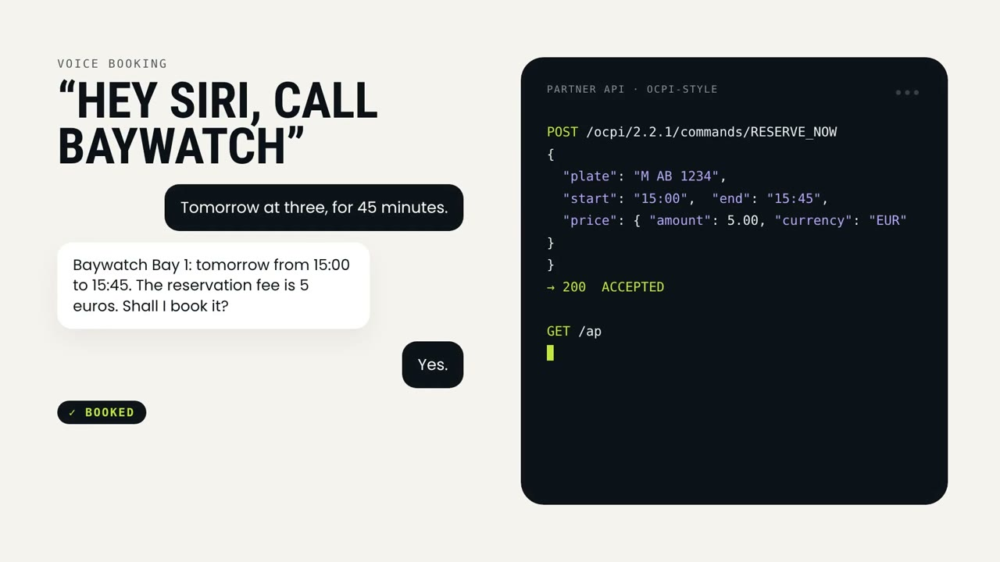
</p>

</details>

## Status (2026-10-24)

- **Built:**
  - **The full cycle on real hardware, run live** on 24 Oct at 17:10–17:14 on Bay 2 (`lock-0003`):
    1. Booked with "Book now".
    2. The arm stayed up, with only the driver's plate on the camera's list.
    3. The camera lowered the arm by itself, and the app checked the driver in.
    4. The car left, the arm went up again, and the list was emptied.
  - **Booking v2:** every GoingElectric charger is bookable on a 15-minute grid, up to 60 days ahead. **Book now** books this exact moment: from the 15-minute block under way, for at least an hour.
  - **Three Baywatch bays:** `bw-1` → `lock-0001` and `bw-2` → `lock-0003` are real Ecurious locks, and `bw-3` has no hardware. The lock service's list of the team's locks decides which can be used.
  - **Booking rules:** demand pricing (from €4 per booking at a fast bay, €5 at normal demand, never above €10), a 100% no-show fee, cancellation tiers, overstay after 5 free minutes, blocked-bay re-routing with a €5 credit, and walk-up unlock.
  - The operator dashboard, the partner API (OCPI-style), and voice booking (Vapi).
  - **The Flutter app** ([mobile/](mobile/)): every web screen ported to Flutter, on the same API and Clerk accounts. Tested in Chrome; Android and iOS are configured but not yet built ([mobile/README.md](mobile/README.md)).
- **Not wired yet:** Stripe card payments are built and tested (test mode), but the app uses the demo payment for now ([payments.md](docs/payments.md)).

**Code:** the private GitHub repo [BayWatch](https://github.com/mohamedaminehamdi/BayWatch), on `main`.

## The challenge in short

Ecurious provides reservation hardware that physically keeps a bay free, plus a camera that reads license plates, behind the Ecurious server. GoingElectric provides public charger data.
- **Mandatory:** a live cycle **reserve → arrive (plate check-in) → charge → release** on the real hardware. This is a prerequisite for the top ranks.
- **Mission areas:** at least two from No-Shows, Blocked Bays, Plate Recognition, Interoperability, New Use Cases, Utilisation and Business Case.
- **Judging:** Technical Implementation 30% · Concept & Innovation 20% · Business Case & CPO Value 20% · Interoperability & Scalability 15% · Documentation & Pitch 15%. GDPR handling is expected.

Full brief: [CHALLENGE.md](CHALLENGE.md).

| Deliverable | Where |
|---|---|
| 1. App prototype showing GoingElectric charge points | [web/](web/): Explore map and list with live GoingElectric data, every charger bookable |
| 2. Full reservation cycle on the hardware | `bw-1` and `bw-2` drive the real Ecurious locks, run live on 24 Oct ([status](#status-2026-10-24)): [data flows §1](docs/data-flows.md#1-book--arrive--charge--leave-a-bay-with-a-real-lock) and [hardware-integration.md](docs/hardware-integration.md) |
| 3. Documentation: architecture, API calls, data flows, decisions, tools, what didn't work | [docs/](#docs) |
| 4. Answers to at least two mission areas | Six areas: [docs/mission-areas.md](docs/mission-areas.md) |
| 5. Limitations and scaling | [docs/limitations-and-scaling.md](docs/limitations-and-scaling.md) |

## User flows

**Driver** (web app, installable as a PWA):
1. Land on the home page. Sign up or sign in with Google or email (Clerk). The first reservation is free.
2. Add your car: plate, nickname, and consent to plate recognition.
3. **Explore:** the three Baywatch bays (big violet dots) and every GoingElectric charger, with search, "Locate me" and a fast filter. A virtual LED shows whether a bay can be unlocked right now.
4. **Book now:** one tap books this moment, from the 15-minute block under way, for at least an hour (16:23 → 16:15–17:30). On a Baywatch bay, the barrier goes up at once. **Choose a time** picks a start on the grid (today or up to 60 days ahead) and a length up to the bay's maximum (2 h at a fast bay). You see:
   - **The price:** from €4 for an hour at a fast bay, €5 at normal demand, never above €10. It's fixed once you book.
   - **The credit used.**
   - **The cancellation schedule.**

   Accept the fees and pay (demo payment). At most 3 upcoming bookings.
5. **Your booking:**
   - reminders the day before, 30 min before (the booking goes live) and 5 min before;
   - Navigate (by car), and arrive within 15 min of the start (of booking, for Book now).
   - On a Baywatch bay, the arm rises 10 min before the start (at once for Book now). The camera's allow-list holds only your plate, so the camera lowers the arm for your car. Misreads are tolerated, and "I'm at the bay" works when the camera saw your car but couldn't read the plate.
6. **Blocked bay:** if another car is in your bay, you're re-routed to the nearest free bays ("Book instead"), you get a **€5 credit**, and you can cancel for free.
7. **Charge, then leave:** 5 free minutes after your slot, then €0.30/min. You get a receipt, and your history is under Bookings.
8. **Walk-up:** at a free bay, "Unlock now" lets you in at once, free, until the next booking. On a real lock, the camera must read one of your own plates.
9. **Voice:** tap the mic and say "Book bay 1 now for an hour". The assistant reads the quote back and books when you say yes ([voice-booking.md](docs/voice-booking.md)).

**Operator** (email listed in `OPERATOR_EMAILS`):
- **Per real bay:** status, blocked-bay alerts (with email), and the hardware panel (guard, sensor, health, "Lower the arm").
- **7-day KPIs:** including credits issued, walk-ups, and the overstay split.

**Partner app:** reserve a bay by id through OCPI-style `RESERVE_NOW`, with an optional `ecurious_start` and `ecurious_blocks` ([api.md](docs/api.md)). Other apps can also link drivers to a public bay page (`/bay/{id}`).

## Pricing

- **Drivers** pay one reservation fee per booking, fixed when they book: from €4 for an hour at a fast bay, €5 at normal demand, never more than €10.
  - Cancelling is free for 2 minutes after booking.
  - A no-show keeps the fee.
  - After the slot, there are 5 free minutes to leave, then €0.30 a minute, at most €12.
- **Operators** pay €19 per bay per month for Bay Guard: blocked-bay alerts, the dashboard and the partner API.

Rules and sources: [reservation-model.md](docs/reservation-model.md) and [unit-economics.md](docs/unit-economics.md).

## API

- Every route: [docs/api-calls.md](docs/api-calls.md).
- Other charging apps: the partner guide [docs/api.md](docs/api.md), and the OpenAPI 3.1 spec served at [`/openapi.json`](web/public/openapi.json).

| Main endpoints | What they do |
|---|---|
| `GET /api/bays`, `GET /api/bays/{id}/availability`, `GET /api/bays/{id}/quote` | Map bays, a day's 15-min blocks, a price (`?start=now` for Book now) |
| `POST /api/reservations`, `POST /api/reservations/{id}/{cancel, checkin, charge, finish}` | Book (`now: true` for Book now) and manage a booking |
| `POST /api/bays/{id}/unlock` | Walk-up |
| `POST /ocpi/2.2.1/commands/RESERVE_NOW`, `CANCEL_RESERVATION`, `GET /api/partner/v1/reservations/{id}` | Partner apps (`Authorization: Token`) |

## Quickstart

You need Node.js 20.9 or later, and npm.

```bash
cd web
npm install
cp .env.example .env      # fill in the keys below
npx -y clerk@latest init  # only if web/.env.local has no Clerk keys yet: creates a temporary, claimable app
npm run dev               # http://localhost:3000
npm test                  # booking rules and schedule, hardware client, partner API, payments, voice, …
```

| Variable (`web/.env`) | Needed for | Notes |
|---|---|---|
| `GE_API_KEY` | Chargers on the map | [Request a key](https://www.goingelectric.de/stromtankstellen/api/new/) (needs an account) |
| `ECURIOUS_BAYS` | The Baywatch bays | e.g. `bw-1:lock-0001,bw-2:lock-0003,bw-3:`. A lock that isn't on the team's list at start-up is dropped, and its bay runs simulated. |
| `BAY_ADDRESS`, `BAY_LAT`, `BAY_LNG`, `BAY_POWER_KW` | Where the Baywatch bays are, and their power | Placeholder Berlin coordinates: set the venue's (the 150 m check-in and walk-up radius) |
| `HOLIDAYS` | Demand pricing | Dates priced as busy (`YYYY-MM-DD,…`) |
| `ECURIOUS_API_KEY`, `ECURIOUS_LIVE` | Real locks | Both are needed: `ECURIOUS_LIVE=1` makes bookings on `bw-1` and `bw-2` move the real arms. `ECURIOUS_MOCK=1` is the kill switch. |
| `ECURIOUS_WHITELIST`, `ECURIOUS_LOCK_ID`, `ECURIOUS_VACANT_MS` | Real locks | The camera whitelist is **on** by default (`0` turns it off). `ECURIOUS_LOCK_ID` is the CLI's lock (no fallback). The "car left" debounce defaults to 10 000 ms. |
| `SIMULATOR` | The demo panel | `1` = fake plates, a car in a simulated bay, site demand, "Simulate a week". Allowed with live hardware: demo events are refused (403) on bays with a real lock. |
| `WEBHOOK_SECRET` | Other camera sources | Required by `POST /api/plate-events`. Empty = all rejected. |
| `OPERATOR_EMAILS` | Operator dashboard and alert emails | Comma-separated sign-in emails |
| `RESEND_API_KEY`, `ALERT_FROM` | Alert emails | Optional |
| `OCPI_PARTNER_TOKENS` | Partner API | `name:token,…` (lowercase names, 32+ characters). Empty = closed. |
| `STRIPE_SECRET_KEY`, `NEXT_PUBLIC_STRIPE_PUBLISHABLE_KEY` | Card payments (test mode) | Paused for the demo, so the demo payment is used ([payments.md](docs/payments.md)). |
| `VOICE_DEMO`, `VAPI_BEARER_SECRET`, `VOICE_SESSION_SECRET`, `VOICE_DEMO_USER_ID` | Voice booking | `VOICE_DEMO=1` switches it on (demo payment). The bearer secret authenticates Vapi's webhook, and the session secret signs the mic's tokens. |
| `NEXT_PUBLIC_VAPI_PUBLIC_KEY`, `NEXT_PUBLIC_VAPI_ASSISTANT_ID` | The in-app mic | The mic shows only when both are set |
| Clerk keys | Sign-in | Written to `web/.env.local` by `clerk init`. Claim the app with `npx clerk auth login`. |

**The Flutter app** needs the web app running (it serves the API and the app's config):

```bash
cd mobile
flutter pub get
flutter run -d chrome   # phones: add --dart-define=API_URL=http://<your computer's LAN address>:3000
```

## Docs

| Doc | What's in it | Last updated |
|---|---|---|
| [architecture.md](docs/architecture.md) | Components, module map, state, security | 2026-10-24 |
| [api-calls.md](docs/api-calls.md) | Every route and every external call | 2026-10-24 |
| [api.md](docs/api.md) | Integration guide for other charging apps (OCPI-style) | 2026-10-24 |
| [data-flows.md](docs/data-flows.md) | The v2 cycle with real hardware, blocked bays, walk-up, voice, fees, personal data | 2026-10-24 |
| [reservation-model.md](docs/reservation-model.md) | Booking v2 rules and prices, with 18 sources | 2026-10-24 |
| [hardware-integration.md](docs/hardware-integration.md) | The Ecurious locks: API, events, safety, test plan, what the live server really does | 2026-10-24 |
| [payments.md](docs/payments.md) | Stripe test mode: holds and capture | 2026-10-24 |
| [voice-booking.md](docs/voice-booking.md) | Voice booking with Vapi | 2026-10-24 |
| [unit-economics.md](docs/unit-economics.md) | Revenue split and hardware payback | 2026-10-24 |
| [decisions.md](docs/decisions.md) | Design decisions | 2026-10-24 |
| [tools.md](docs/tools.md) | Frameworks, services, test tooling, AI usage | 2026-10-24 |
| [what-did-not-work.md](docs/what-did-not-work.md) | What failed and what we did | 2026-10-24 |
| [mission-areas.md](docs/mission-areas.md) | Our answers to six mission areas | 2026-10-24 |
| [limitations-and-scaling.md](docs/limitations-and-scaling.md) | Limitations, scaling, open items | 2026-10-24 |
| [web/PRODUCT.md](web/PRODUCT.md), [web/DESIGN.md](web/DESIGN.md) | Product brief, and the brand system | 2026-10-24 |
| [mobile/README.md](mobile/README.md) | The Flutter app: screen map to the web, running it, sign-in, platforms | 2026-10-24 |

## Glossary

| Term | Meaning |
|---|---|
| **CPO** | Charge Point Operator: runs the chargers and pays for Bay Guard alerts |
| **eMSP** | e-Mobility Service Provider: the app or card a driver uses. A partner for our API. |
| **OCPI** | Open Charge Point Interface: the roaming protocol. Its Commands module has `RESERVE_NOW` / `CANCEL_RESERVATION`. |
| **OCPP** | Open Charge Point Protocol: charger ↔ backend, with `ReserveNow` / `CancelReservation` |
| **LPR** | License plate recognition: the bay camera |
| **Walk-up** | Unlocking a free bay on the spot, without a booking |

Fair play: we only use the provided hardware and server access (only the locks the lock service assigns to the team: `lock-0001` and `lock-0003` on 24 Oct), respect GoingElectric's terms, and treat plates as personal data ([data-flows.md](docs/data-flows.md#personal-data)).
