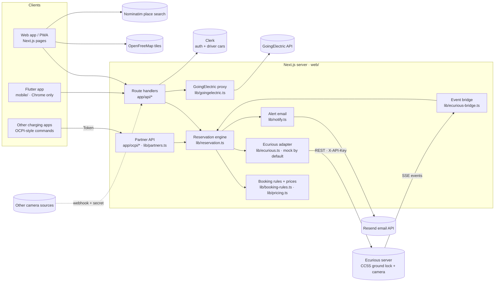

# Architecture

_Last updated: 2026-10-24. Covers the driver app, the operator dashboard, the booking rules, the partner API, and the real hardware client. The client is built and verified read-only; the arm test is phase 2 of [hardware-integration.md](hardware-integration.md). The UI uses the Ecurious brand ([web/DESIGN.md](../web/DESIGN.md))._

## Components

| Component | Role | Status |
|---|---|---|
| **Next.js 16 app** ([web/](../web/)) | Landing page, the driver app, the operator dashboard **and** the API. One backend for every client. | Built |
| **Flutter app** ([mobile/](../mobile/)) | Mobile client for the same API, with a map and bay status. | Legacy: it predates sign-in and can't reserve until it gets Clerk ([limitations](limitations-and-scaling.md)) |
| **Clerk** | Sign-in (Google and email). Stores drivers' cars in private, server-only user metadata. | Built. The app is temporary until claimed |
| **GoingElectric** | Public charge points for the map, the list and the landing page. The key stays on the server. | Built, with live data |
| **Ecurious server** | Our team "Baywatch" has three camera bays, `lock-0001` to `lock-0003`. Each is a Chang Cheng CC5S ground lock with a car sensor and a plate camera. REST calls raise and lower the arm and set the camera's plate list. A live event stream (SSE) carries plate reads and sensor changes. | The real client is built and verified read-only. Live mode needs `ECURIOUS_API_KEY` **and** `ECURIOUS_LIVE=1`; the default is the mock. Moving the arm is the supervised phase-2 test ([hardware-integration.md](hardware-integration.md)). |
| **Resend** | Emails operators when a bay is blocked. | Built. Skipped without `RESEND_API_KEY` |
| **OpenFreeMap + MapLibre** | Vector map tiles, with no key needed. | Built |
| **Nominatim** | Place search in Explore, on submit only. | Built |
| **Partner API** | OCPI 2.2.1-style `RESERVE_NOW` / `CANCEL_RESERVATION` for other apps, a status route to poll, the public bay page `/bay/{id}`, and the spec at `/openapi.json` ([api.md](api.md)). | Built |

## Module map (`web/lib`)

| Module | What it does |
|---|---|
| [reservation.ts](../web/lib/reservation.ts) | The engine. One bay with one active reservation: reserve (passing the booked plate to `hw.reserve([plate])`), camera plate events, the car sensor's "car left" (`vacated()`, no plate needed), fallback check-in, a second plate, extension, cancel, charge, finish, the no-show timer, waitlist and priority, blocked-bay alerts, the public, owner and operator views, booking history, and analytics records. |
| [booking-rules.ts](../web/lib/booking-rules.ts) | Pure rules, no imports: slot limits by type, the demand-priced fee with a cap, the no-show fee, cancellation tiers, the arrival deadline, overstay, the reliability (repeat no-show) rule, and the reminder schedule. The sources for every number are in [reservation-model.md](reservation-model.md). |
| [pricing.ts](../web/lib/pricing.ts) | The app's own prices (extension, the Bay Guard plan, the 70% CPO share), receipt labels, and the fee sentences drivers read before paying. |
| [plates.ts](../web/lib/plates.ts) | Plate normalising, masking (`MA•••34`), and misread-tolerant matching. |
| [geo.ts](../web/lib/geo.ts) | Distance in metres (haversine), formatting, and the Google Maps directions link. |
| [server.ts](../web/lib/server.ts) | Config from env, including the refusal to load with `SIMULATOR=1` and `ECURIOUS_LIVE=1` together. The shared engine instance plus the 5 s timer, the auth helpers (`requireUser`, `requireOperator`), the webhook secret check, the JSON body reader with a 10 KB limit, and the `handle()` error-to-JSON wrapper. |
| [vehicles.ts](../web/lib/vehicles.ts) | Drivers' cars in Clerk `privateMetadata`, with validation, a consent timestamp and a maximum of 5. |
| [goingelectric.ts](../web/lib/goingelectric.ts) | GoingElectric queries: map-area search, and the cached "chargers near the bay" for the landing page. |
| [notify.ts](../web/lib/notify.ts) | The blocked-bay email through Resend's REST API. It never throws and never includes a plate. |
| [operator.ts](../web/lib/operator.ts) | 7-day KPIs in Berlin calendar days, and a seeded "Simulate a week" generator for demos, priced by the same rules as real bookings. Also the hardware panel (`hardwarePanel()`): the guard's state, the warnings, and the bay's health rows. |
| [partners.ts](../web/lib/partners.ts) | The partner API: token parsing and constant-time checks, the per-partner rate limit, OCPI envelopes, `RESERVE_NOW` / `CANCEL_RESERVATION` validation, idempotent retries, the status view, and bay availability for `/bay/{id}`. The one adapter between partners and the engine. |
| [ecurious.ts](../web/lib/ecurious.ts) | The hardware adapter, keeping the mock's signatures ([details](hardware-integration.md#how-the-app-maps-onto-the-hardware)): • `reserve()` reads the bay fresh and refuses if it's offline or a car is on the sensor. Otherwise it raises the arm with `cancelAutoLift: true` and replaces the camera's plate list with `[]`, or with the booked plate when `ECURIOUS_WHITELIST=1`. • `release()` lowers the arm with `cancelAutoLift: true` and clears the list. • `status()` is cached for 5 s with a stale fallback, and never throws. The REST client has timeouts, read retries and a 30 s cooldown after a failed command. It's the mock unless live. |
| [ecurious-events.ts](../web/lib/ecurious-events.ts) | The SSE client: the parser, the event names (the real `lock:`-prefixed ones and the documented ones), reconnect with backoff, and a 60 s silence watchdog |
| [ecurious-bridge.ts](../web/lib/ecurious-bridge.ts) | Events → the engine, one at a time and in order: • a plate read becomes `plateEvent(plate, 'in')`, and in an unbooked bay it's remembered for 2 min; • the car sensor turning occupied checks the car in; • "car left" is `vacated()`, after 10 s of vacant. [instrumentation.ts](../web/instrumentation.ts) starts it once per server, in live mode only. |
| [ecurious-cli.ts](../web/lib/ecurious-cli.ts) | A console for the supervised phase-2 test: one call per run, with plates masked |

The UI lives in [web/components](../web/components/): `explore/`, `booking/`, `bookings/`, `vehicles/`, `operator/`, `landing/`, `ui/` and `demo-panel.tsx`. Pages are in [web/app](../web/app/): `(marketing)` is the landing page, `(auth)` the sign-in and sign-up pages, and `(app)` the signed-in app.

The hardware's `online` flag drives an offline state across the UI. The map pin reads "Ecurious bay, offline right now", and Reserve is disabled everywhere: the bay panel, the reserve dialog and the bay page. The header pill shows the hold's end time ("Held until 13:38") rather than a countdown.

## State and persistence

- **Everything is in memory, in one process.** The engine is a singleton on `globalThis`, so dev reloads keep it ([server.ts](../web/lib/server.ts)). It needs one long-running `next start`. Serverless hosting such as Vercel would give each instance its own state.
- **What's held:**
  - the current reservation;
  - up to 300 ended reservations, with plates erased;
  - up to 100 alerts (150 including simulated ones);
  - a 30-line event log with no plates;
  - the waitlist, the priority window and the demand setting;
  - partner links (a partner's `reservation_id` → our reservation, up to 500) and each partner's rate-limit window;
  - the hardware status cache and the event bridge, also on `globalThis`, because instrumentation and the route handlers are bundled separately.
- A restart loses all of the above. **Drivers' cars survive**, because they're stored in Clerk.
- A 5-second timer (`expire`) handles no-shows, due reminders and expired priority windows.
- The browser polls `GET /api/state` every 2 s. The operator dashboard polls every 3 s.

## Security

| Concern | How it's handled | Where |
|---|---|---|
| Who is the driver | Clerk session. `requireUser()` returns 401 when signed out. The `(app)` pages call `auth.protect()`. | [server.ts](../web/lib/server.ts), [(app)/layout.tsx](../web/app/%28app%29/layout.tsx) |
| Whose reservation | `ownerId` = the Clerk user id, checked on every action (403 otherwise). It's never sent to any client. | `own()` in [reservation.ts](../web/lib/reservation.ts) |
| Plate source | Reserving takes a `vehicleId` from the driver's own account, never a free-text plate. | [api/reservations](../web/app/api/reservations/route.ts) |
| Camera webhook | `x-webhook-secret`, compared in constant time. **Fails closed** when `WEBHOOK_SECRET` is unset, because a matching plate opens the bay. | `secretOk()` in [server.ts](../web/lib/server.ts) |
| Demo controls | `/api/sim/*` and "Simulate a week" exist only with `SIMULATOR=1`, and also need sign-in. With `ECURIOUS_LIVE=1` as well, the server refuses to load (a config error), because a faked plate would move the real arm. | [api/sim](../web/app/api/sim/plate-events/route.ts) |
| Real hardware | Live mode is opt-in: it needs the key **and** `ECURIOUS_LIVE=1`, and `ECURIOUS_MOCK=1` is the kill switch. Fair play: only bays our key lists, and any other `ECURIOUS_LOCK_ID` is refused. The arm never rises onto a car or on an offline bay. Commands are never retried. The key is sent only in `X-API-Key` and is scrubbed from errors. | [ecurious.ts](../web/lib/ecurious.ts), [hardware-integration.md](hardware-integration.md#errors-and-safety) |
| Camera plate list | Every bay shipped with `["*"]`, so the camera lowered the arm for any car. A hold replaces the list with `[]`, or with the booked plate if `ECURIOUS_WHITELIST=1`, and clears it again at check-in, cancel or no-show. | [ecurious.ts](../web/lib/ecurious.ts) |
| Operators | An email allowlist in `OPERATOR_EMAILS`: the API returns 403, and `/operator` returns 404 for anyone else. Operators can also lower the arm for recovery (`POST /api/operator/hardware/lower`), which is logged. | `requireOperator()` |
| Fallback check-in | "I'm at the bay" only works if the bay itself saw a car in the last 3 minutes (an unreadable plate read, or the presence sensor), plus the driver within 150 m. The client's location alone never lowers the arm. | `checkInManually()` in [reservation.ts](../web/lib/reservation.ts) |
| Partner apps | `Authorization: Token …`, plain or Base64, from `OCPI_PARTNER_TOKENS`. Compared as SHA-256 digests with `timingSafeEqual` against every entry. **Fails closed** when none is configured (401). | `partnerFor()` in [partners.ts](../web/lib/partners.ts) |
| Partner isolation and abuse | Each partner sees and cancels only its own reservations. 60 requests a minute per partner (429 + `Retry-After`). Every field is validated, and `response_url` is checked but never called (no SSRF). | [partners.ts](../web/lib/partners.ts), [api.md](api.md#limits-and-abuse) |
| Input limits | JSON bodies capped at 10 KB (413), invalid JSON returns 400, and coordinates and plates are validated. | `body()` |
| CORS | `/api/*` allows any origin (`GET, POST, DELETE, OPTIONS`) for the Flutter web client. Sessions are cookies, which aren't sent cross-origin, and the Flutter app will use Bearer tokens. | [next.config.ts](../web/next.config.ts) |
| Secrets | `GE_API_KEY`, the Clerk keys, `RESEND_API_KEY`, `ECURIOUS_API_KEY`, `WEBHOOK_SECRET` and `OCPI_PARTNER_TOKENS` live only in `web/.env*` (gitignored). The GoingElectric key never reaches the browser. | [.env.example](../web/.env.example) |

Personal data and when it's erased: see [data-flows.md](data-flows.md#personal-data).
