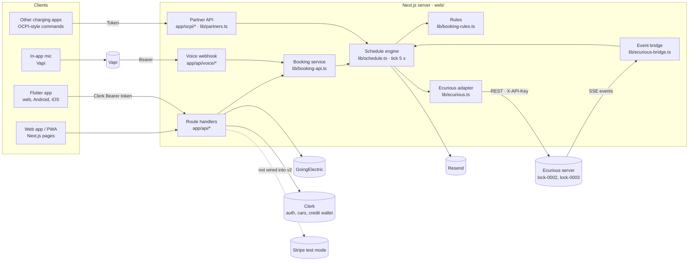

# Architecture

_Last updated: 2026-10-24, booking v2. Product name **Baywatch** (internals and the hardware vendor keep "Ecurious")._

## Components

| Component | Role | Status |
|---|---|---|
| **Next.js 16 app** ([web/](../web/)) | Landing, the driver app, the operator dashboard, and the API | Built |
| **Schedule engine** ([schedule.ts](../web/lib/schedule.ts)) | Every bay's bookings on the 15-min grid: quote, book, cancel, check-in, walk-up, no-show, blocked bays, credits, reminders, hardware sync. A 5 s tick. | Built |
| **Bays** ([bays.ts](../web/lib/bays.ts)) | The three Baywatch bays from `ECURIOUS_BAYS` (`bw-1` → `lock-0002`, `bw-2` → `lock-0003`, `bw-3` no lock), and every GoingElectric charger as `ge-<id>` with a simulated guard | Built |
| **Ecurious locks** | Two real CC5S ground locks with a camera, via REST and an SSE event stream | Live: the dev server runs with `ECURIOUS_LIVE=1` ([hardware-integration.md](hardware-integration.md)) |
| **Clerk** | Sign-in. Drivers' cars and the credit wallet live in `privateMetadata`. | Built. Temporary app until claimed |
| **GoingElectric** | Public chargers, every one bookable | Built |
| **Vapi** | Voice booking (quote, then confirm) | Built, behind `VOICE_DEMO=1` ([voice-booking.md](voice-booking.md)) |
| **Stripe** | Card holds and capture, test mode | Built and tested, **not yet wired into v2** ([payments.md](payments.md)) |
| **Resend** | Blocked-bay alert emails | Built |
| **OpenFreeMap + MapLibre, Nominatim** | Map and place search | Built |
| **Flutter** ([mobile/](../mobile/)) | The native app: a port of every web screen (landing, sign-in, explore, booking, bookings, cars, operator, demo, voice) on the same API, signed in with the same Clerk accounts through a Bearer session token | Built. Tested in Chrome; Android and iOS builds not yet run ([mobile/README.md](../mobile/README.md)) |

## Module map (`web/lib`)

| Module | What it does |
|---|---|
| [booking-types.ts](../web/lib/booking-types.ts) | The shared v2 types: `Bay`, `Availability`, `Quote`, `ReservationView`, charges, reminders |
| [booking-rules.ts](../web/lib/booking-rules.ts) | Pure rules: classes, demand by time, the grid, gaps, fees, the cancel schedule, idle fees, the six reminders. The v1 section at the end is deprecated. |
| [schedule.ts](../web/lib/schedule.ts) | The engine (see above), including `bayView`, availability, the walk-up and fallback evidence rules, credits and `firstFree` |
| [booking-api.ts](../web/lib/booking-api.ts) | Booking for server code: the same checks for the web, voice and partners. **Payment is decided here**, never from a browser field. |
| [booking.ts](../web/lib/booking.ts) | That service bound to the server's engine (`bays`, `quote`, `reserve`, `reserveFromWeb`) |
| [bays.ts](../web/lib/bays.ts) | Bay config: the Baywatch bays and GoingElectric bays. `lock-0001` is retired. |
| [ecurious.ts](../web/lib/ecurious.ts) | The lock adapter, per `lockId`: `raise` (whitelist the booked plate, never `wildcard`), `lower`, `status`, validating against `GET /locks`. Safety rules: never raise onto a car, refuse offline bays, a 30 s cooldown, no write retries. |
| [ecurious-events.ts](../web/lib/ecurious-events.ts), [ecurious-bridge.ts](../web/lib/ecurious-bridge.ts) | SSE client with the live event names (`lock:status_changed`, `lock:car_presence_changed`, `lock:photo_captured`), and events → engine |
| [partners.ts](../web/lib/partners.ts) | The OCPI-style partner API |
| [voice.ts](../web/lib/voice.ts) | Voice tools: `quote_reservation` / `confirm_reservation`, signed session tokens, bearer check |
| [payments.ts](../web/lib/payments.ts), [revenue.ts](../web/lib/revenue.ts) | Stripe test-mode holds and capture; who gets what from a booking ([unit-economics.md](unit-economics.md)) |
| [legacy.ts](../web/lib/legacy.ts) | The old screens' view of v2 (deprecated) |
| [server.ts](../web/lib/server.ts) | Config, auth helpers, the engine singleton and its 5 s tick, the webhook secret check, the JSON body limit |
| [operator.ts](../web/lib/operator.ts), [notify.ts](../web/lib/notify.ts), [plates.ts](../web/lib/plates.ts), [vehicles.ts](../web/lib/vehicles.ts), [goingelectric.ts](../web/lib/goingelectric.ts), [geo.ts](../web/lib/geo.ts) | KPIs and the hardware panel; alert email; plate matching; cars; GoingElectric; distance |

## State and persistence

- **In memory, in one process:** every bay's schedule, booking history, alerts and the event log. A restart loses bookings, but not cars or credits (Clerk). It needs one long-running `next start`.
- **Shared on `globalThis`:** the engine, the hardware cache and the bridge, because instrumentation and the route handlers are bundled separately.
- **Polling:** the browser polls the API. Hardware status is cached for 5 s per lock.

## Security

| Concern | How it's handled |
|---|---|
| Who the driver is | Clerk session: the web's cookie, or the Flutter app's session JWT as `Authorization: Bearer`. Pages call `auth.protect()`, and routes return 401 when signed out. `GET /api/config` hands the app only `NEXT_PUBLIC_*` values. |
| Whose booking | Owner checks on every booking route. Anyone else's booking is a 404. |
| Payment | Decided on the server ([booking-api.ts](../web/lib/booking-api.ts)): the browser's `payment` field is ignored. The demo payment is allowed only without Stripe keys, or with `VOICE_DEMO=1` for voice. |
| Opening an arm | A plate match (the camera's whitelist or our misread-tolerant match). The fallback check-in needs camera or sensor evidence in the last 3 min, plus 150 m. Walk-up on a real lock needs the camera to read **one of the driver's own plates**. When the camera lowers the arm by itself for a plate we couldn't read, it counts as the booked car only while the camera's list is **confirmed** to hold just that booking's plates (`listOk === true`); an unknown or 'any car' list proves nothing, and the driver uses "I'm at the bay". Location alone never lowers an arm. |
| Demo events | `SIMULATOR=1` routes are refused (403) on bays with a real lock. They only listen to their own camera and sensor. |
| Hardware | Live only with the key and `ECURIOUS_LIVE=1` (`ECURIOUS_MOCK=1` is the kill switch). Only the team's locks, validated against `GET /locks`; `lock-0001` is never called. |
| Voice | The Vapi webhook needs `VAPI_BEARER_SECRET`. The driver comes from a token signed with its own `VOICE_SESSION_SECRET`, never from the caller or the model. **Open:** phone calls carry no token and book as `VOICE_DEMO_USER_ID` when it's set (it isn't by default), so anyone with the number could book, a "now" booking included ([limitations](limitations-and-scaling.md)). |
| Partners | `Authorization: Token`, constant-time and failing closed. 60 requests a minute. Partner URLs are never called. |
| Camera webhook | `x-webhook-secret`, failing closed, and refused on real-lock bays |
| Input and secrets | JSON bodies capped at 10 KB. Keys only in `web/.env*` (gitignored). |
