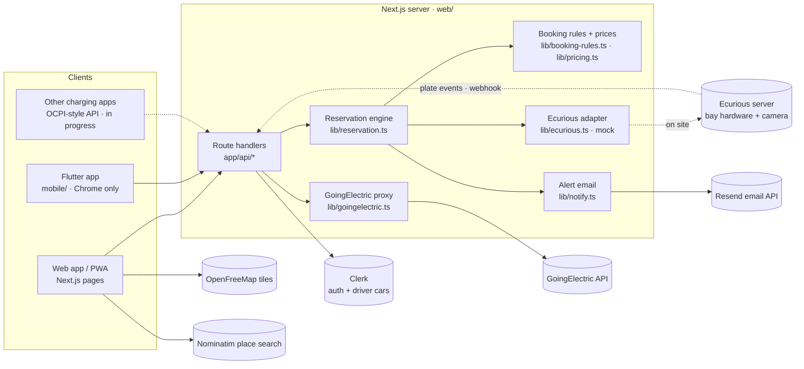

# Architecture

_Last updated: 2026-10-24. Covers the driver view, operator dashboard and booking rules. Still in progress: wiring the new fee rules into the UI, the partner API and the Ecurious brand retheme._

## Components

| Component | Role | Status |
|---|---|---|
| **Next.js 16 app** ([web/](../web/)) | Landing page, the driver app, the operator dashboard **and** the API. One backend for every client. | Built |
| **Flutter app** ([mobile/](../mobile/)) | Mobile client for the same API, with a map and bay status. | Legacy: it predates sign-in and can't reserve until it gets Clerk ([limitations](limitations-and-scaling.md)) |
| **Clerk** | Sign-in (Google and email). Stores drivers' cars in private, server-only user metadata. | Built. The app is temporary until claimed |
| **GoingElectric** | Public charge points for the map, the list and the landing page. The key stays on the server. | Built, with live data |
| **Ecurious server** | Reserves and releases the bay, reads its status, and sends camera plate events. | **Mocked** in [lib/ecurious.ts](../web/lib/ecurious.ts). We get the real API on site |
| **Resend** | Emails operators when a bay is blocked. | Built. Skipped without `RESEND_API_KEY` |
| **OpenFreeMap + MapLibre** | Vector map tiles, with no key needed. | Built |
| **Nominatim** | Place search in Explore, on submit only. | Built |
| **Partner API** | OCPI-style `RESERVE_NOW` / `CANCEL_RESERVATION` for other apps ([api.md](api.md)). | In progress |

## Module map (`web/lib`)

| Module | What it does |
|---|---|
| [reservation.ts](../web/lib/reservation.ts) | The engine. One bay with one active reservation: reserve, camera plate events, fallback check-in, a second plate, extension, cancel, charge, finish, the no-show timer, waitlist and priority, blocked-bay alerts, the public, owner and operator views, booking history, and analytics records. |
| [booking-rules.ts](../web/lib/booking-rules.ts) | Pure rules, no imports: slot limits by type, the demand-priced fee with a cap, the no-show fee, cancellation tiers, the arrival deadline, overstay, the reliability (repeat no-show) rule, and the reminder schedule. The sources for every number are in [reservation-model.md](reservation-model.md). |
| [pricing.ts](../web/lib/pricing.ts) | The app's own prices (extension, the Bay Guard plan, the 70% CPO share), receipt labels, and the fee sentences drivers read before paying. |
| [plates.ts](../web/lib/plates.ts) | Plate normalising, masking (`MA•••34`), and misread-tolerant matching. |
| [geo.ts](../web/lib/geo.ts) | Distance in metres (haversine), formatting, and the Google Maps directions link. |
| [server.ts](../web/lib/server.ts) | Config from env, the shared engine instance plus the 5 s timer, the auth helpers (`requireUser`, `requireOperator`), the webhook secret check, the JSON body reader with a 10 KB limit, and the `handle()` error-to-JSON wrapper. |
| [vehicles.ts](../web/lib/vehicles.ts) | Drivers' cars in Clerk `privateMetadata`, with validation, a consent timestamp and a maximum of 5. |
| [goingelectric.ts](../web/lib/goingelectric.ts) | GoingElectric queries: map-area search, and the cached "chargers near the bay" for the landing page. |
| [notify.ts](../web/lib/notify.ts) | The blocked-bay email through Resend's REST API. It never throws and never includes a plate. |
| [operator.ts](../web/lib/operator.ts) | 7-day KPIs in Berlin calendar days, and a seeded "Simulate a week" generator for demos. |
| [ecurious.ts](../web/lib/ecurious.ts) | The hardware adapter: `reserve()`, `release()`, `status()`. A mock today. |

The UI lives in [web/components](../web/components/): `explore/`, `booking/`, `bookings/`, `vehicles/`, `operator/`, `landing/`, `ui/` and `demo-panel.tsx`. Pages are in [web/app](../web/app/): `(marketing)` is the landing page, `(auth)` the sign-in and sign-up pages, and `(app)` the signed-in app.

## State and persistence

- **Everything is in memory, in one process.** The engine is a singleton on `globalThis`, so dev reloads keep it ([server.ts](../web/lib/server.ts)). It needs one long-running `next start`. Serverless hosting such as Vercel would give each instance its own state.
- **What's held:**
  - the current reservation;
  - up to 300 ended reservations, with plates erased;
  - up to 100 alerts (150 including simulated ones);
  - a 30-line event log with no plates;
  - the waitlist, the priority window and the demand setting.
- A restart loses all of the above. **Drivers' cars survive**, because they're stored in Clerk.
- A 5-second timer (`expire`) handles no-shows, due reminders and expired priority windows.
- The browser polls `GET /api/state` every 2 s. The operator dashboard polls every 3 s.

## Security

| Concern | How it's handled | Where |
|---|---|---|
| Who is the driver | Clerk session. `requireUser()` returns 401 when signed out. The `(app)` pages call `auth.protect()`. | [server.ts](../web/lib/server.ts), [(app)/layout.tsx](../web/app/%28app%29/layout.tsx) |
| Whose reservation | `ownerId` = the Clerk user id, checked on every action (403 otherwise). It's never sent to any client. | `own()` in [reservation.ts](../web/lib/reservation.ts) |
| Plate source | Reserving takes a `vehicleId` from the driver's own account, never a free-text plate. | [api/reservations](../web/app/api/reservations/route.ts) |
| Camera webhook | `x-webhook-secret`, compared in constant time. **Fails closed** when `WEBHOOK_SECRET` is unset, because a matching plate opens the bay. | `secretOk()` in [server.ts](../web/lib/server.ts) |
| Demo controls | `/api/sim/*` and "Simulate a week" exist only with `SIMULATOR=1`, and also need sign-in. Never enable this next to real hardware. | [api/sim](../web/app/api/sim/plate-events/route.ts) |
| Operators | An email allowlist in `OPERATOR_EMAILS`: the API returns 403, and `/operator` returns 404 for anyone else. | `requireOperator()` |
| Partner apps | `Authorization: Token …` from `OCPI_PARTNER_TOKENS`, constant-time and failing closed. No calls to partner-supplied URLs (SSRF). | In progress, see [api.md](api.md) |
| Input limits | JSON bodies capped at 10 KB (413), invalid JSON returns 400, and coordinates and plates are validated. | `body()` |
| CORS | `/api/*` allows any origin for the Flutter web client. Sessions are cookies, which aren't sent cross-origin, and the Flutter app will use Bearer tokens. | [next.config.ts](../web/next.config.ts) |
| Secrets | `GE_API_KEY`, the Clerk keys, `RESEND_API_KEY`, `ECURIOUS_API_KEY` and `WEBHOOK_SECRET` live only in `web/.env*` (gitignored). The GoingElectric key never reaches the browser. | [.env.example](../web/.env.example) |

Personal data and when it's erased: see [data-flows.md](data-flows.md#personal-data).
