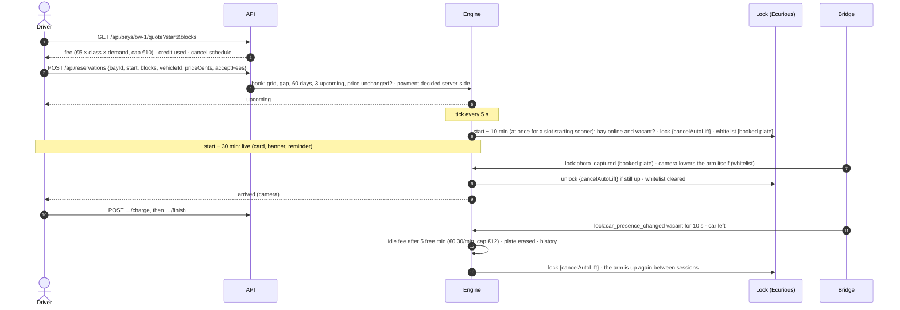
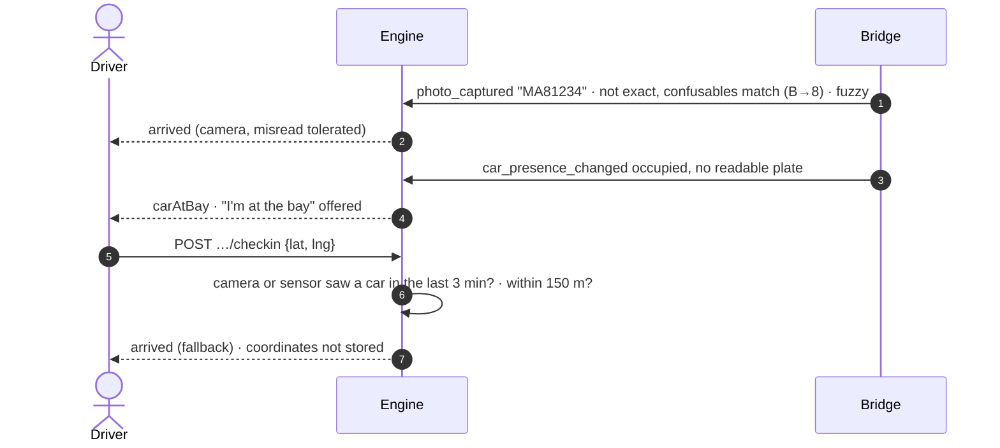
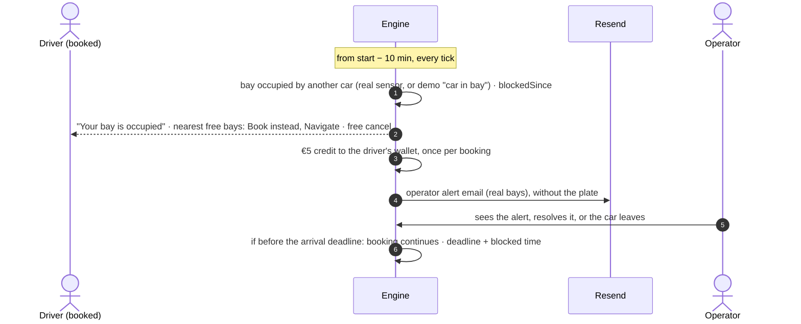
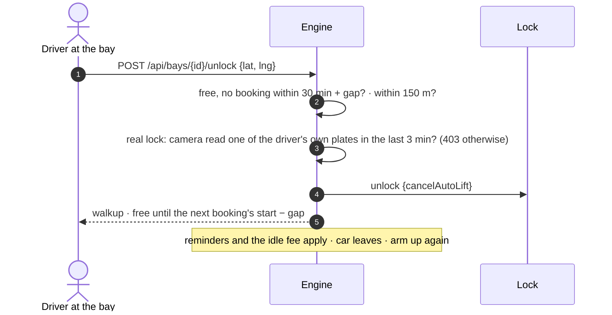
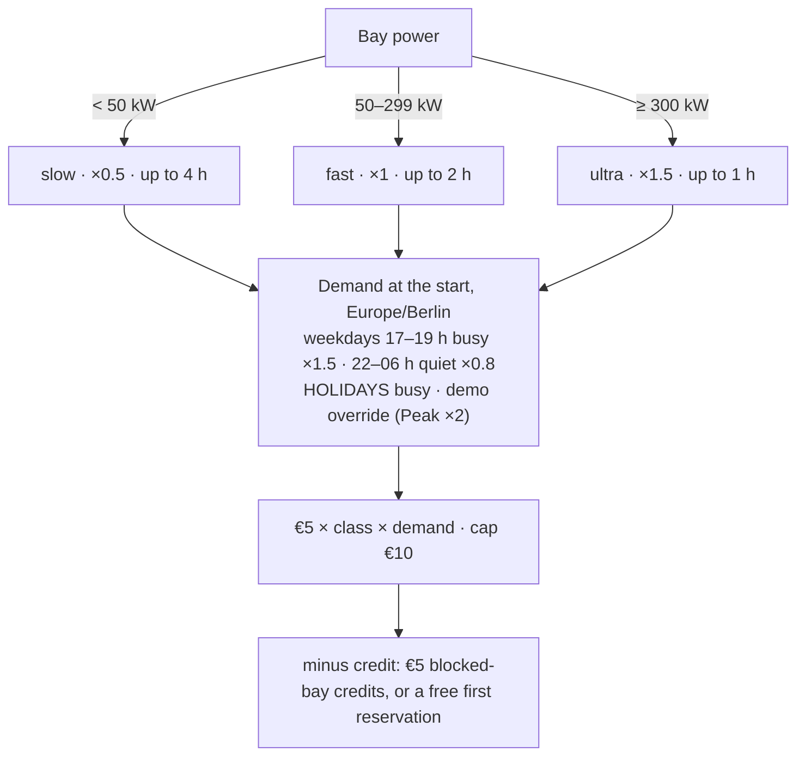
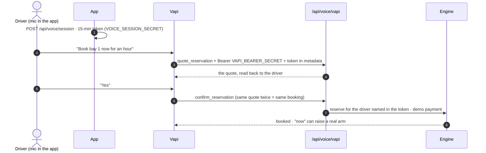

# Data flows

_Last updated: 2026-10-24, booking v2. The engine is [schedule.ts](../web/lib/schedule.ts), with a tick every 5 s ([server.ts](../web/lib/server.ts)). Fees come from [booking-rules.ts](../web/lib/booking-rules.ts), and the lock calls go through [ecurious.ts](../web/lib/ecurious.ts)._

Participants below:
- **Driver:** the web app.
- **Engine:** the schedule.
- **Lock:** the Ecurious adapter, in live mode. A simulated bay keeps the same states in memory, with no calls.
- **Bridge:** the live event stream → the engine ([ecurious-bridge.ts](../web/lib/ecurious-bridge.ts)).

## 1. Book → arrive → charge → leave (a bay with a real lock)

- **A refused raise** (a car over the arm, an offline bay) at booking time rolls the booking back: 502 `The bay could not be reserved: <reason>`.
- **Before the start:** reminders at the day before (if booked > 1 day ahead), start − 30 min and start − 5 min.
- **During the session:** reminders at end − 5 min, at the end and at end + 5 min. Each is re-checked when sent.

## 2. Misread or unreadable plate, and the fallback check-in

A driver's location alone never lowers an arm.

## 3. Blocked bay → re-route + €5 credit

## 4. Walk-up ("Unlock now")

## 5. No-show

- **The deadline:** start + 15 min, moved by any blocked time.
- **When it passes:** the driver pays **100%** of the fee, the booking becomes `no_show`, the plate is erased, and a real arm goes back up for the next driver.

## 6. Fee calculation

- **Fixed at booking.** A different quote at Pay time is a 409, "The price is now €X".
- **Table by class and demand:** [reservation-model.md](reservation-model.md#fees-by-class-and-demand).

## 7. Voice booking

- **Phone calls** ("Hey Siri, call Baywatch") book for `VOICE_DEMO_USER_ID`, or are sent to the app.
- **Plates** never go to the voice model.
- **Details:** [voice-booking.md](voice-booking.md).

## 8. Partner app reservation

A partner sends `RESERVE_NOW` with `location_id` = bay id, the plate and consent, an optional `ecurious_start` and `ecurious_blocks`, and the fee its driver accepted. The answer is final (ACCEPTED, or REJECTED with the reason, including hardware refusals), and the partner polls the status route. The driver checks in by plate like any other. See [api.md](api.md).

## 9. Hardware events

| Event (live server) | Bridge → engine |
|---|---|
| `lock:photo_captured` | A plate read: the booked car checks in, or another car blocks the bay. On a free bay it's kept for 3 min as walk-up evidence. |
| `lock:car_presence_changed` occupied | Car in the bay: check-in evidence, or a blocker |
| `lock:car_presence_changed` vacant for 10 s | The car left: the session ends with any idle fee, and the arm goes up again |
| `lock:status_changed` | Arm position, for the cached status |
| `lock:heartbeat` | Health and battery |

The documented names were `status_change` and `vehicle_presence`. The live server sends the `_changed` forms, which the parser has handled since 2026-10-24 ([what-did-not-work](what-did-not-work.md)).

## Personal data

| Data | Stored where | Who sees it | Erased when |
|---|---|---|---|
| Drivers' cars (plate, nickname, consent time) | Clerk `privateMetadata` | The driver only | When the car or account is deleted |
| Credit wallet (`creditCents`, `firstFree`) | Clerk `privateMetadata` | The driver | With the account |
| Booked plate (and "different car" plate) | The engine, in memory | The owner, masked | **When the booking ends** |
| Booked plate on the camera's own list | The vendor's camera | The camera | Cleared at the end of the booking |
| Camera reads (walk-up evidence) | In memory, at most 3 min | Nobody | After 3 min |
| Blocking car's plate | The alert, in memory | Operators only, never emailed | On resolve |
| Locations (check-in, walk-up) | Not stored | – | Used once for the 150 m check |
| Voice calls | Vapi | – | Plates are never sent to the voice model |
| Booking outcomes | In memory | The owner; operators as aggregates | On restart |
