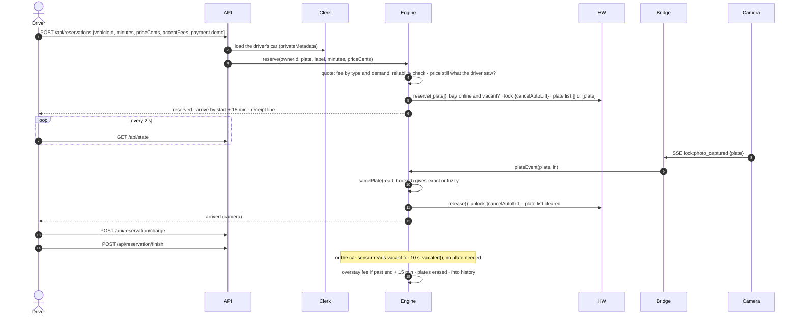
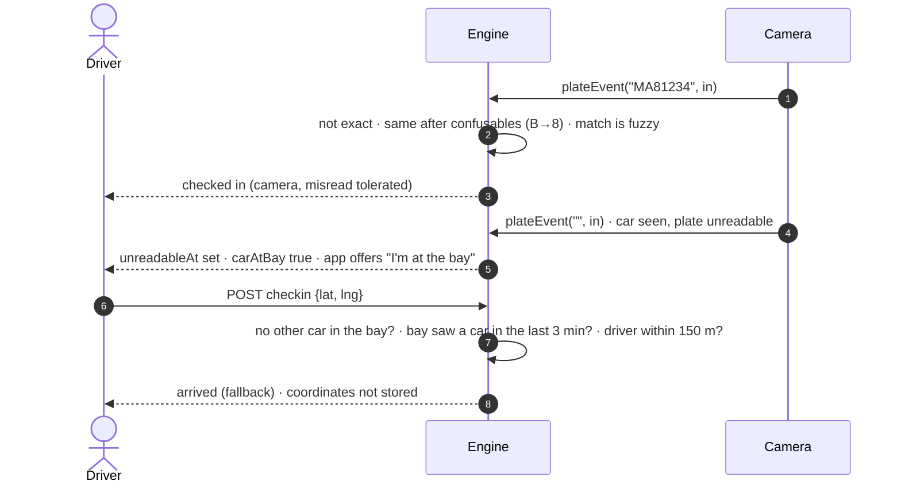
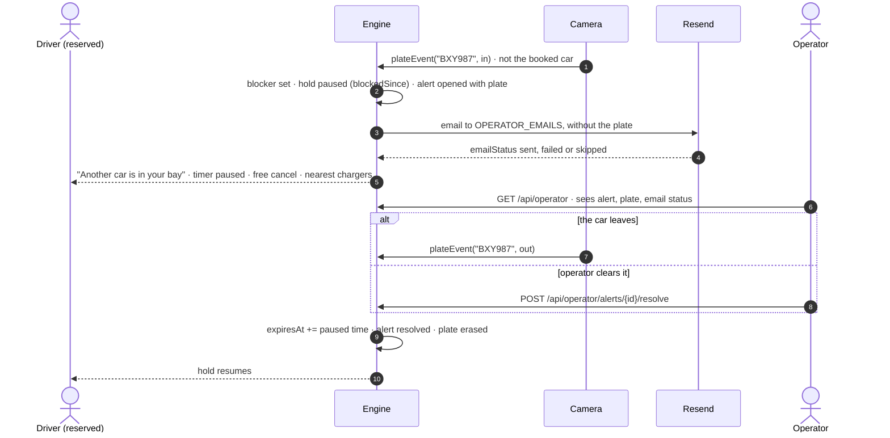
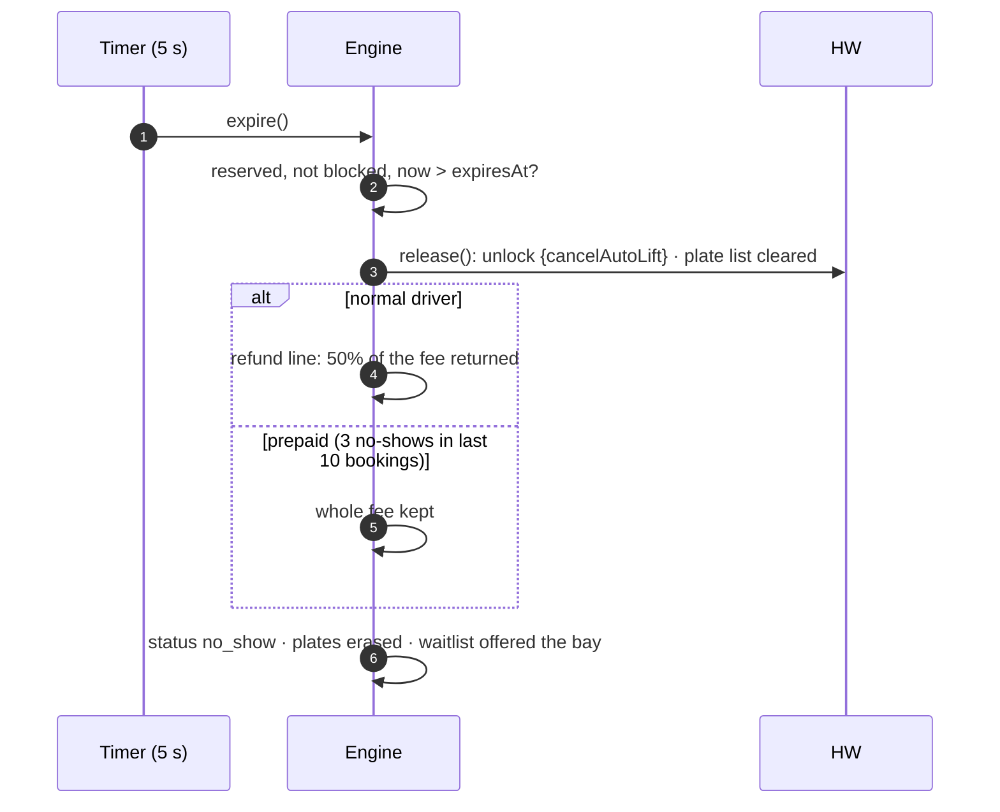
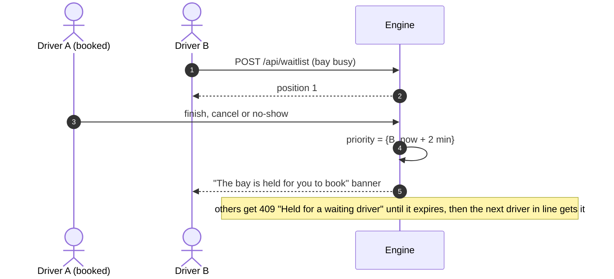
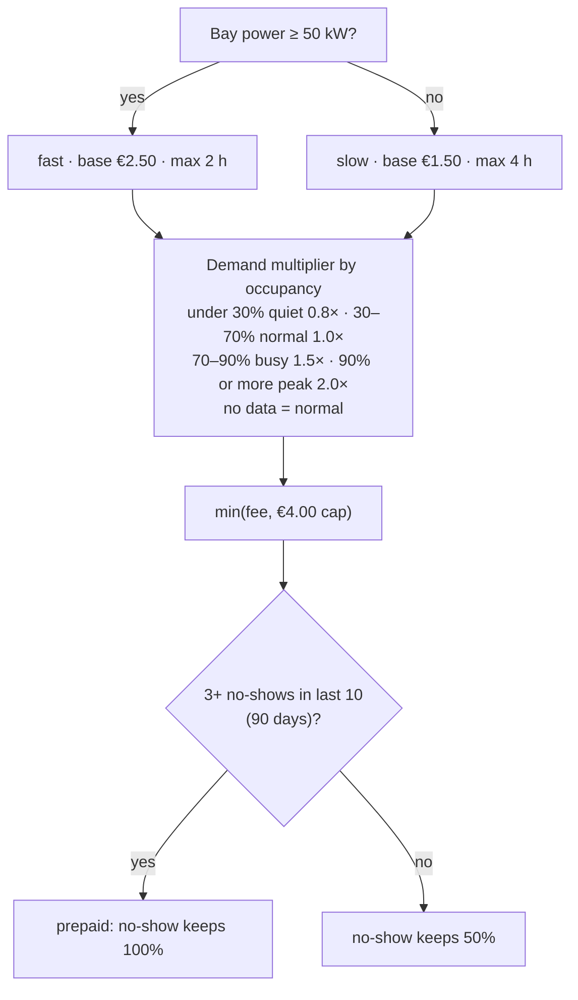
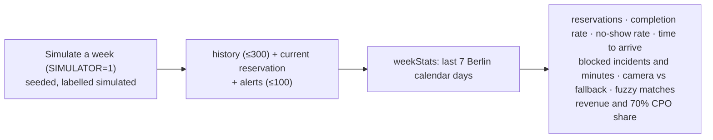
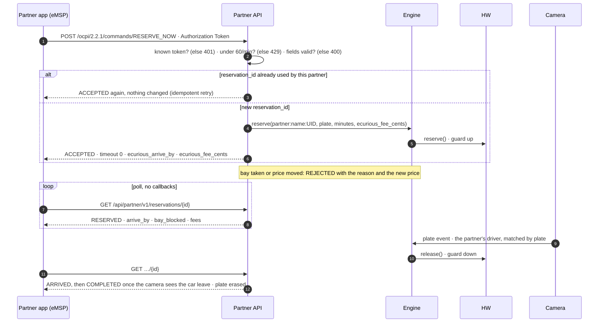
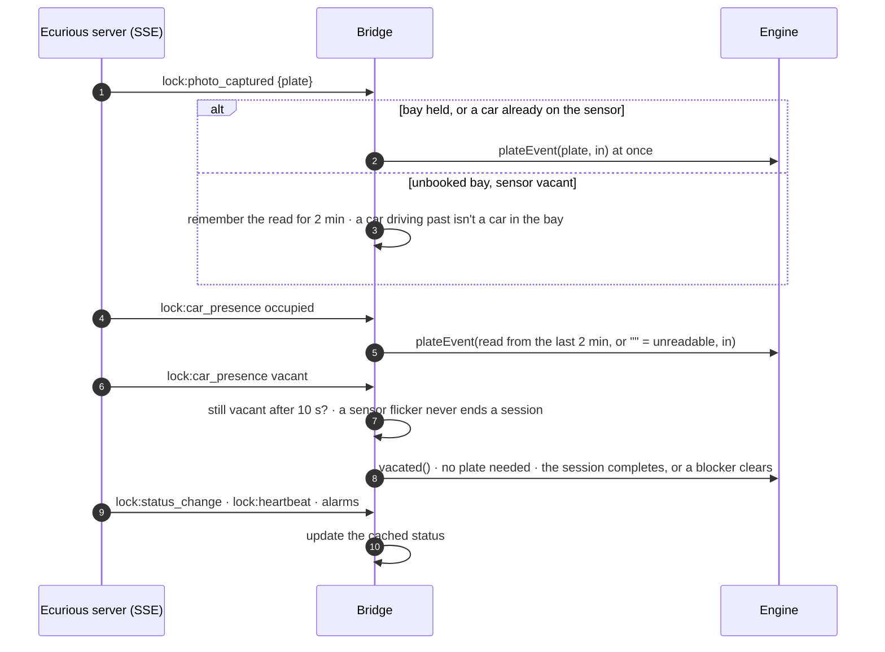

# Data flows

_Last updated: 2026-10-24. Fees follow [booking-rules.ts](../web/lib/booking-rules.ts), and they're wired end to end: the session picker, the price check, the demand control and the reminders. The partner flow (§8) is built._

Participants used below:
- **Driver:** the web app.
- **API:** Next.js route handlers.
- **Engine:** [reservation.ts](../web/lib/reservation.ts).
- **HW:** the Ecurious adapter ([ecurious.ts](../web/lib/ecurious.ts)): the built-in mock unless live mode is on.
- **Camera:** the bay camera. Its reads reach the engine through the Ecurious server's live event stream and the **Bridge** ([ecurious-bridge.ts](../web/lib/ecurious-bridge.ts), §9).

## 1. Reserve → arrive → charge → release

- **Failures:**
  - If `hw.reserve()` fails or refuses (the bay is offline, or a car is on the sensor), the booking is rolled back: 502 `The bay could not be reserved: <reason>`.
  - If `hw.release()` fails at check-in, the state is restored and the driver sees an error.
  - If it fails on cancel, the booking stays reserved, so the driver can retry.
  - If the arm is left up with no booking, for example after a timed-out command, an operator lowers it from the hardware panel.
- **End of the session:** nothing moves, because the arm has stayed down since check-in.
- **Other cameras:** a camera source other than the Ecurious stream can post the same events to `POST /api/plate-events`, with the webhook secret.

## 2. Misread or unreadable plate, and the fallback check-in

The fallback needs **evidence from the bay itself**: an unreadable plate read or, once it's wired, the presence sensor. Without that, the app shows no button and the server answers 409. A driver's reported location can be spoofed, so it's only an extra check, and on its own it never lowers the arm.

Matching ([plates.ts](../web/lib/plates.ts)):
1. Exact match after normalising.
2. Otherwise, canonical confusable characters: O/Q/D→0, I→1, B→8, S→5, Z→2, G→6.
3. Otherwise, at most one edit for plates of 6 or more characters.

It's only ever compared against the one active booking, plus its optional "different car today" plate.

## 3. Blocked bay → alert → email → resolve

With no booking, a car parking in the bay just marks it occupied. That's normal charging, so it raises no alert, and new reservations are refused until the car leaves.

## 4. No-show expiry and fees

- **"Prepaid":** every prototype booking is paid up front, so "prepaid" means the 50% refund is withheld.
- **A failed release:** the engine retries on the next tick. After a failed command, the adapter refuses new ones for 30 s, so that's about two attempts a minute.

## 5. Waitlist and priority

## 6. Fee and pricing calculation

- **Cancellation:**
  - Free within 2 min of booking, or while the bay is blocked.
  - Otherwise a share of the no-show fee by lead time to the start: ≥24 h 0%, ≥2 h 30%, ≥10 min 40%, later 60%.
  - With "reserve now" the start is the booking time, so after 2 minutes it's always 60%.
- **What that gives,** in euros ([booking-rules.ts](../web/lib/booking-rules.ts), half a cent always rounds down in the driver's favour):

| Demand | Fast fee | No-show | Cancel after 2 min | Slow fee | No-show | Cancel after 2 min |
|---|---|---|---|---|---|---|
| Quiet | 2.00 | 1.00 | 0.60 | 1.20 | 0.60 | 0.36 |
| Normal (or no data) | 2.50 | 1.25 | 0.75 | 1.50 | 0.75 | 0.45 |
| Busy | 3.75 | 1.87 | 1.12 | 2.25 | 1.12 | 0.67 |
| Peak | 4.00 (cap) | 2.00 | 1.20 | 3.00 | 1.50 | 0.90 |

- **Extension:** +5 min for €0.50, once.
- **Overstay:** 15 min free after the session end, then €0.25/min (fast) or €0.10/min (slow), capped at €12.
- The fee is fixed when booking. If demand changed since the driver saw the price, the engine answers 409 "the price is now €X" and they confirm again.

## 7. Operator KPIs

## 8. Partner app reservation (OCPI-style)

- **Ownership:**
  - Partner bookings are owned by `partner:<name>:<token uid>`, so the no-show and prepay rules follow each driver token.
  - A partner only ever sees and cancels its own `reservation_id`s.
- **Cancelling:** `CANCEL_RESERVATION` works only while the booking is `RESERVED`, and costs what an app driver would pay.
- **Ending:** a checked-in partner booking ends when the camera sees the car leave, because there's no Finish button for it.
- **Price:** the partner sends the fee its driver accepted (`ecurious_fee_cents`). If demand has moved the price since, the answer is REJECTED with the new price, exactly like the app's 409.

Details and examples: [api.md](api.md).

## 9. Camera and sensor events from the real bay

- **Order:** events run one at a time, in order, because `plateEvent` waits for the arm. A failing event is logged, and the next one still runs.
- **Departure needs no plate:** `vacated()` also ends a session that was checked in by hand.
- **Other bays:** their events are ignored.
- **Event names:** from the vendor dashboard's code. Only `connected` and `lock:heartbeat` have been seen live so far ([hardware-integration.md](hardware-integration.md#the-live-events)).

## Personal data

| Data | Stored where | Who sees it | Erased when |
|---|---|---|---|
| Driver's cars (plate, nickname, consent time) | Clerk `privateMetadata`, server-only | The driver only | When the driver deletes the car or the account |
| Booked plate (and "different car" plate) | The engine, in memory | The owner as `MA•••34` only. The camera matching runs server-side. | **When the reservation ends**, for every outcome |
| Blocking car's plate | The alert, in memory | Operators only. Never in emails or the event log. | When the alert is resolved (by camera or operator) |
| Plate reads from the bay camera (SSE) | The bridge, in memory: the last read for the 2-minute window, and the checked-in plate until the car leaves | Nobody. Never logged, never in `hardware` status, and masked in the CLI. | Replaced by the next read; the checked-in plate is dropped when the car leaves |
| Booked plate on the camera's own list (only with `ECURIOUS_WHITELIST=1`) | The vendor's camera, through the Ecurious server | The camera | Cleared at check-in, cancel or no-show: on the camera only for the length of the hold |
| Partner driver's plate (`ecurious_license_plate`, sent with `ecurious_plate_consent: true`) | The engine, in memory | The partner as a masked `license_plate_hint` only | **When the reservation ends**, as for app drivers |
| Partner driver's token uid | Part of the owner id `partner:<name>:<UID>`, kept with the booking outcome | Nobody: it's never in a response | On restart. The reliability rule only looks back 90 days. `token.contract_id` is validated and never stored. |
| Partner links (their `reservation_id` → our reservation) | In memory, up to 500 | That partner only | The oldest is dropped past 500, and all are lost on restart |
| Fallback-check-in location | Not stored | – | Used once for the 150 m check, which comes on top of the camera evidence |
| Booking outcomes (status, times, fees) | History, in memory, capped at 300 | The owner. Operators as aggregates. | On restart. The reliability rule only looks back 90 days. |
| Event log | In memory, last 30 | Shown in the demo panel and the operator view | Rolling. Never contains plates or identities. |
| Clerk identity (email, name) | Clerk | The driver. The server checks operator emails. | Clerk account deletion |

Clerk is a US processor, so GDPR relies on its data processing agreement and standard contractual clauses. Partner apps collect their drivers' consent and need a data processing agreement with us ([api.md](api.md)).
