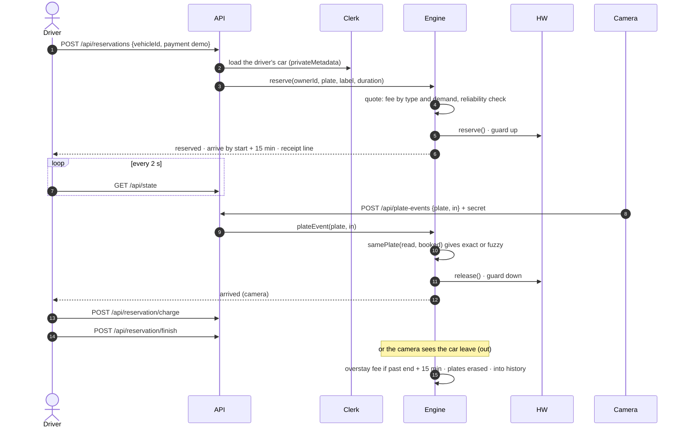
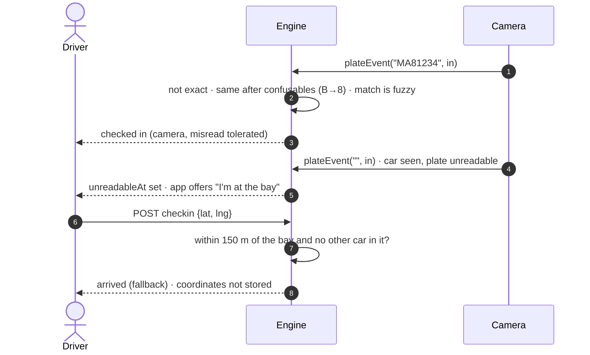
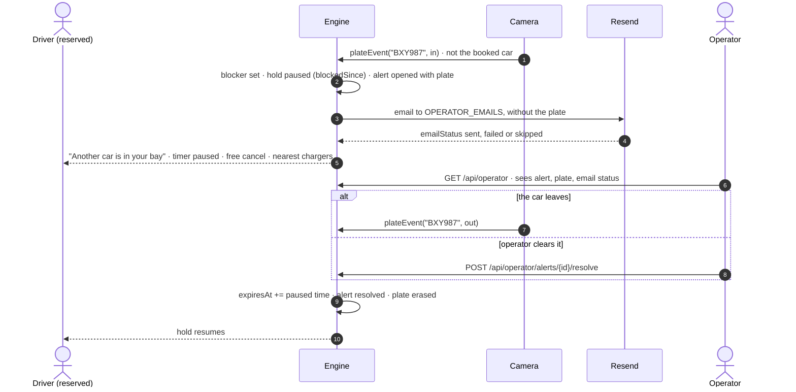
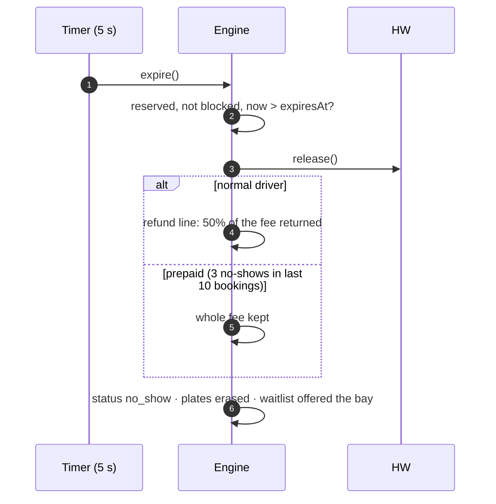
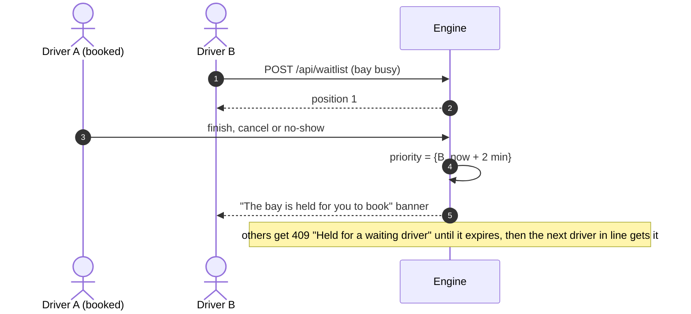
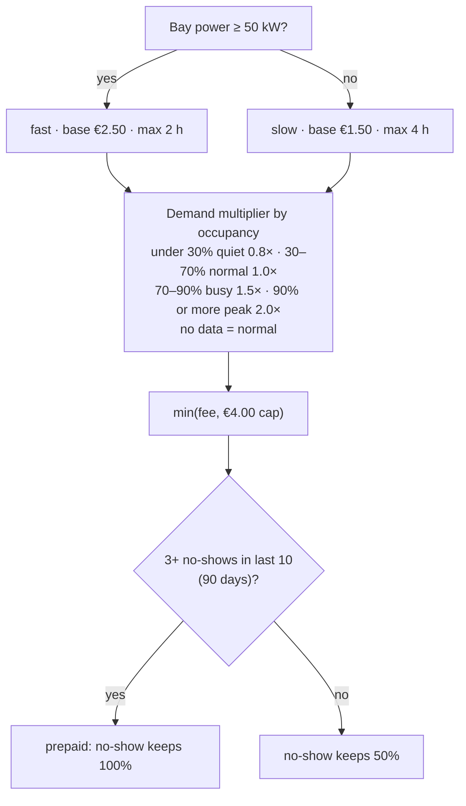
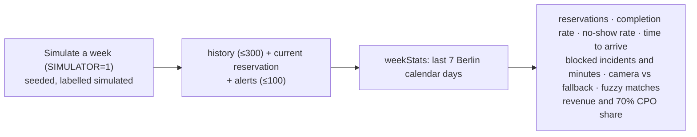
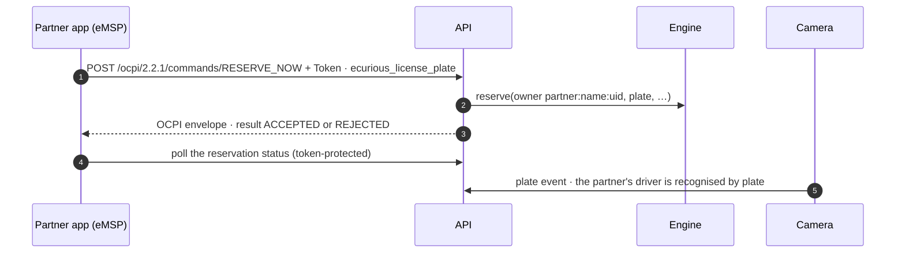

# Data flows

_Last updated: 2026-10-24. Fees follow [booking-rules.ts](../web/lib/booking-rules.ts). The duration picker and demand control are still being wired into the UI. The partner flow is in progress._

Participants used below:
- **Driver:** the web app.
- **API:** Next.js route handlers.
- **Engine:** [reservation.ts](../web/lib/reservation.ts).
- **HW:** the Ecurious adapter, a mock today.
- **Camera:** the bay camera via the Ecurious server webhook.

## 1. Reserve → arrive → charge → release

If `hw.reserve()` fails, the reservation is rolled back (502). If `hw.release()` fails, the state is restored and the driver sees an error.

## 2. Misread or unreadable plate, and the fallback check-in

Matching ([plates.ts](../web/lib/plates.ts)):
1. Exact match after normalising.
2. Otherwise, canonical confusable characters: O/Q/D→0, I→1, B→8, S→5, Z→2, G→6.
3. Otherwise, at most one edit for plates of 6 or more characters.

It's only ever compared against the one active booking, plus its optional "different car today" plate.

## 3. Blocked bay → alert → email → resolve

With no booking, a car parking in the bay just marks it occupied. That's normal charging, so it raises no alert, and new reservations are refused until the car leaves.

## 4. No-show expiry and fees

## 5. Waitlist and priority

## 6. Fee and pricing calculation

- **Cancellation:**
  - Free within 2 min of booking, or while the bay is blocked.
  - Otherwise a share of the no-show fee by lead time to the start: ≥24 h 0%, ≥2 h 30%, ≥10 min 40%, later 60%.
  - With "reserve now" the start is the booking time, so after 2 minutes it's always 60%.
- **Extension:** +5 min for €0.50, once.
- **Overstay:** 15 min free after the session end, then €0.25/min (fast) or €0.10/min (slow), capped at €12.
- The fee is fixed when booking. If demand changed since the driver saw the price, the engine answers 409 "the price is now €X" and they confirm again.

## 7. Operator KPIs

## 8. Partner app reservation (OCPI-style, in progress)

Details and examples: [api.md](api.md).

## Personal data

| Data | Stored where | Who sees it | Erased when |
|---|---|---|---|
| Driver's cars (plate, nickname, consent time) | Clerk `privateMetadata`, server-only | The driver only | When the driver deletes the car or the account |
| Booked plate (and "different car" plate) | The engine, in memory | The owner as `MA•••34` only. The camera matching runs server-side. | **When the reservation ends**, for every outcome |
| Blocking car's plate | The alert, in memory | Operators only. Never in emails or the event log. | When the alert is resolved (by camera or operator) |
| Fallback-check-in location | Not stored | – | Used once for the 150 m check |
| Booking outcomes (status, times, fees) | History, in memory, capped at 300 | The owner. Operators as aggregates. | On restart. The reliability rule only looks back 90 days. |
| Event log | In memory, last 30 | Shown in the demo panel and the operator view | Rolling. Never contains plates or identities. |
| Clerk identity (email, name) | Clerk | The driver. The server checks operator emails. | Clerk account deletion |

Clerk is a US processor, so GDPR relies on its data processing agreement and standard contractual clauses. Partner apps collect their drivers' consent and need a data processing agreement with us ([api.md](api.md)).
