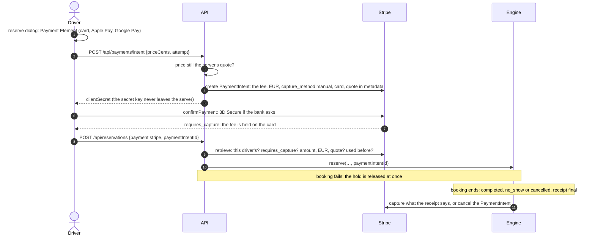

# Card payments with Stripe (test mode)

Drivers pay the reservation fee by card through Stripe, **in test mode only**. The card is authorized when the driver books, and charged once the booking ends, for exactly what the receipt says. Without Stripe keys the app keeps its demo payment. The rules for the amounts are in [`reservation-model.md`](reservation-model.md); Stripe sources are marked [P1]–[P9] ([list](#sources)).

**Status, 24 Oct 2026:**

- **Built and tested:** [`web/lib/payments.ts`](../web/lib/payments.ts), `POST /api/payments/intent`, and the Payment Element component. Tests: `cd web && node --test lib/payments.test.ts`.
- **Wiring:** connecting these to the booking flow takes a small change in files other agents own; see [Wiring it in](#wiring-it-in). The wiring builds and passes every test in a copy of `web/`.
- **Not yet run against Stripe:** no keys were set.
- **Booking model v2** (advance booking up to 60 days, new fees) is being built now. The [v2 plan](#booking-model-v2-the-capture-and-charge-plan) below says what changes. Until v2 lands, the amounts in this doc are v1's.

## Set it up

1. **Create a free Stripe account** at [dashboard.stripe.com/register](https://dashboard.stripe.com/register). Test mode needs no activation and no bank details.
2. **Switch the Dashboard to test mode** (or open a sandbox), then open **Developers → API keys**.
3. **Add both keys to `web/.env`.** It's gitignored. Never commit keys or paste them into chat.

   ```bash
   STRIPE_SECRET_KEY=sk_test_...
   NEXT_PUBLIC_STRIPE_PUBLISHABLE_KEY=pk_test_...
   ```

4. **Restart `npm run dev`.** The publishable key is built into the browser code.
5. **Check the keys:** `cd web && node --env-file=.env --test lib/payments.test.ts`. With test keys it also runs a live test-mode check: a €2.50 hold confirmed with the 4242 card and captured for €1.25, and a 3D Secure card that can't book until the bank's check is done.

Without keys the app takes demo payments, as before. With only one key, booking fails with a clear configuration error. A **live key** (`sk_live_`, `rk_live_` or `pk_live_`) makes the server refuse to run. `STRIPE_ALLOW_LIVE=1` overrides that; don't set it for the hackathon.

**Test cards.** Any future expiry date, any CVC:

| Card | What happens |
|---|---|
| `4242 4242 4242 4242` | Approved |
| `4000 0027 6000 3184` | 3D Secure every time: approve or fail it in Stripe's test window |
| `4000 0000 0000 0002` | Declined |
| `4000 0000 0000 9995` | Declined: insufficient funds |

**Wallets.** Apple Pay needs the domain registered (Dashboard → Settings → Payment method domains) and HTTPS. Google Pay shows in Chrome when the browser has a saved card.

## How a booking is paid



## What each outcome charges

The hold is the reservation fee. When the booking ends, the card is charged the receipt's total, capped at the hold. A partial capture releases the rest of the hold by itself [P1], and charging nothing cancels the PaymentIntent. The amounts come from the receipt, so new fee rules need no change here. Examples for today's rules (v1, reserve now) at normal demand; v2's are [below](#booking-model-v2-the-capture-and-charge-plan):

| Outcome | Rule ([booking-rules.ts](../web/lib/booking-rules.ts)) | Fast (€2.50 held) | Slow (€1.50 held) |
|---|---|---|---|
| Completed | the full fee | €2.50 | €1.50 |
| No-show | `noShowFee`: half the fee | €1.25 | €0.75 |
| No-show, prepaid driver | the full fee | €2.50 | €1.50 |
| No-show after "running late" | half the fee + €0.50 | €1.75 | €1.25 |
| Cancelled in the first 2 min, or while another car blocks the bay | free | released | released |
| Cancelled later (reserve now: 60% of the no-show fee) | `cancellationFee` | €0.75 | €0.45, waived: released |
| Completed with overstay, or after "running late" | the fee + extras | €2.50; extras above the hold aren't charged yet ([overstay](#overstay-pitch-only)) | €1.50, same |

- **Under €0.50 nothing is captured.** Stripe's minimum charge in EUR is €0.50 [P4], and its €0.25 + 1.5% fee would take most of it. The hold is released and the receipt says the amount was waived. In reserve now, this only happens when a slow bay is cancelled after the free 2 minutes at quiet or normal demand (€0.36 or €0.45). Upgrade path: add small amounts to the driver's next booking.
- **The receipt stays the record of what the rules charge.** Operator revenue reads it. A separate `payment` record says what the card was charged, e.g. "Charged to your card: €1.25" or "Card hold released: nothing was charged. €0.45 waived: card payments start at €0.50."
- **Tested against the real reservation engine.** For each outcome, `lib/payments.test.ts` drives `reservation.ts` and checks that the capture equals the `booking-rules.ts` amount.

## Why hold now and charge at the end

- **One card payment per booking, for the final amount.** No refund, since Stripe keeps its fee on a refund [P3], and no extra small charge, since a separate €0.75 payment would lose €0.26 to fees. A hold released before capture costs nothing [P3]. Stripe recommends this pattern for businesses that would otherwise refund soon after the payment [P3].
- **The hold outlasts the booking.** It's valid for 7 days for online card payments; for Visa it's 5 days when the merchant starts the payment [P1]. A reserve-now booking ends within 15 min + 4 h + overstay. v2's advance bookings (up to 60 days ahead) save the card at booking and place the hold 24 h before the start ([v2 plan](#booking-model-v2-the-capture-and-charge-plan)).
- **Prepaid drivers get the same hold.** On a no-show the whole hold is captured. That's the same money as charging up front, with nothing to refund when they cancel.
- **3D Secure (SCA in the EU) runs once, at booking,** in Stripe's window over the reserve dialog. Stripe.js opens its own native modal when a `<dialog>` is open, so the check isn't hidden behind the app's dialog (read in Stripe.js `endive`; not yet run with a real key).
- **Cards only** (`allowed_payment_method_types: ['card']`). That includes Apple Pay and Google Pay. SEPA debit and iDEAL can't hold funds [P1], and redirect-based methods would take the driver out of the dialog.

## Server checks

**Before a booking** (`claimHold` in `POST /api/reservations`). The server never trusts the browser's word that it paid. It retrieves the PaymentIntent from Stripe and requires:

- the Clerk user id in the metadata is the signed-in driver's (403 otherwise);
- status `requires_capture`. `requires_action` means the bank's check isn't done (402);
- `amount_capturable` equals the price the driver confirmed, in EUR, and that price is the quote in the metadata. A mismatched hold can never book anything, so it's released on the spot (409);
- the PaymentIntent has never paid for a booking before, even with two requests at once (409).

If the booking then fails (bay taken, price moved, car not found, hardware down), the route releases the hold before returning the error.

**On the server's side of the payment form** (`POST /api/payments/intent`). The PaymentIntent is created for the server's own quote, never for an amount the browser sends. A stale price gets "The price is now €X", before any card is touched.

**At startup.** A live key throws `Config error: Stripe live keys are refused…`, so every route fails. Error messages and logs never contain a key: only Stripe's error type and request id are logged.

## Errors, retries, idempotency

- **Timeouts and retries:** 10 s per Stripe request instead of Stripe's 80 s, and 2 automatic retries on network errors. Retries reuse the request's idempotency key.
- **Idempotency keys:**

| Call | Key | Effect |
|---|---|---|
| Create the hold | `hold-{user}-{attempt}-{cents}` | `attempt` is made by the dialog and kept until a payment goes through, so a double tap, a timeout or a declined card gets the same PaymentIntent back |
| Capture | `capture-{paymentIntentId}` | A second capture can't happen. Settling again only reads the PaymentIntent. |
| Cancel | `cancel-{paymentIntentId}` | Releasing twice is harmless |
| Create the Customer | `customer-{user}` | One Customer per driver, even if two payments start at once |

- **What drivers see.** Card and form errors come from Stripe.js, in the driver's language. The server maps the rest:

| Stripe says | Driver sees | HTTP |
|---|---|---|
| `card_declined` | "Your card was declined. Try another card." | 402 |
| `card_declined` with `insufficient_funds` | "Your card was declined: not enough funds. Try another card." | 402 |
| `expired_card` | "Your card has expired. Try another card." | 402 |
| `authentication_required`, `payment_intent_authentication_failure`, or status `requires_action` | "Your bank needs to confirm this payment. Pay again and complete the check, or use another card." | 402 |
| Expired authorization: `charge_expired_for_capture` at capture, or a hold Stripe cancelled by itself | The booking's payment is `expired`; the receipt says "The card hold expired: nothing was charged." | none: the booking has ended |
| Connection, API or rate-limit errors | "Card payments are unavailable right now. Try again in a minute." | 503 |
| Wrong or missing API key | "Card payments aren't set up correctly on the server." (logged) | 500 |

- **When settling fails** (Stripe unreachable at the end of a booking), the booking's payment shows `failed` and the error is logged. Capture or cancel the hold by hand in the Dashboard (Payments → Uncaptured). Stripe cancels an uncaptured hold by itself after 7 days [P5].

## Overstay (pitch-only)

Overstay can reach €12 (the cap), which is far more than the €1.20–4.00 hold. A completed booking after "running late" also owes €0.50 more than the hold. A capture can't exceed the hold, and there's only one capture per hold [P1]. Today those extras show on the receipt but aren't charged.

| Option | Verdict |
|---|---|
| A bigger hold: the fee + the €12 overstay cap | Works on standard pricing, but holds €16 for a booking promised at "never more than €4". The driver's bank shows it, and 3D Secure asks the driver to approve €16. |
| Incremental authorization: raise the hold when overstay starts | Cleanest, but IC+ pricing only [P8] |
| Overcapture: capture above the hold | IC+ only, excluded for businesses in the EEA [P7] |
| Bill it with the next booking, or monthly | Cheapest in fees, but the money may never come in |
| **Save the card at booking, charge once at the end (recommended)** | Works on standard pricing, details below |

**How the recommended option works:**

- **At booking:** add `setup_future_usage: 'off_session'` to the same PaymentIntent, and `setupFutureUsage: 'off_session'` to the Elements options. The card is saved to the driver's Customer, and the Payment Element shows the consent text. 3D Secure at booking covers the later charge, which counts as merchant-initiated.
- **At the end, when the total exceeds the hold:** create one off-session PaymentIntent for the whole total and cancel the hold. That's one statement line and one fee.
- **If the bank still asks for authentication** (`authentication_required`): capture the hold and ask the driver in the app to pay the rest.

About 40 lines in `payments.ts`. Saving the card makes banks ask for 3D Secure at booking more often. In v2 the saved card is needed anyway, so this becomes part of the [v2 plan](#booking-model-v2-the-capture-and-charge-plan).

## Booking model v2: the capture and charge plan

Planned, not built. Source: the shared booking v2 spec, §3 (fees) and §8 (API).

**What changes for payments:**

- bookings up to 60 days ahead;
- no-show costs 100%, and cancellation has new tiers;
- overstay is €0.30/min after 5 free minutes, capped at €12;
- credits and a free first booking reduce what's charged;
- walk-up sessions are free unless they overstay.

**What stays:** capture is the receipt's total capped at the hold, nothing under €0.50, the same server checks and idempotency. The new percentages and credits arrive through the receipt.

**v2 amounts at the end of a booking** (normal demand; ultra €3.75 follows the same rules):

| Outcome | v2 rule | Fast (€2.50) | Slow (€1.25) |
|---|---|---|---|
| Completed | 100% of the fee | €2.50 | €1.25 |
| No-show | 100% | €2.50 | €1.25 |
| Cancelled within 2 min of booking, ≥ 24 h before the start, or while the bay is blocked | free (blocked: +€5 credit) | released | released |
| Cancelled 24 h – 30 min before | 10% | €0.25, waived | €0.12, waived |
| Cancelled 30 – 5 min before | 50% | €1.25 | €0.62 |
| Cancelled under 5 min before | 80% | €2.00 | €1.00 |
| Overstay | €0.30/min after 5 free min, at most €12 | above the hold: charged off-session (below) | same |
| Credit or free first booking | lowers the hold to fee − credit | a €0 hold means no PaymentIntent | same |
| Walk-up | free unless it overstays | no hold; overstay off-session | same |

- **The 10% tier is always waived on the card.** Even at the €4.00 cap it's €0.40, under Stripe's €0.50 minimum. To charge it, make the tier "10%, at least €0.50", or carry it to the driver's next booking.
- **Overstay crosses the hold sooner in v2.** After only 5 free minutes, 10 minutes over is €3.00.

### When the card is held: once cancelling can cost money

| Booked | Payment |
|---|---|
| Less than 24 h before the start | Hold at booking: today's built path |
| 24 h or more ahead, up to 60 days | Save the card at booking (a SetupIntent, nothing charged), then place the hold off-session at start − 24 h, with the 24 h reminder |

**Why 24 h, not "within 6 days":**

- Cancelling is free until 24 h before the start, so a hold before then guarantees nothing.
- Drivers' money isn't tied up for days, and a booking cancelled free never touches their statement.
- A hold placed off-session is merchant-initiated: Visa keeps it for 5 days (4 days 18 h) [P1]. One that runs from start − 24 h to the end lasts under 29 h (a 4 h slow session plus the longest overstay), so it never expires.
- One moment for every advance booking, the same tick as the 24 h reminder.

**The 24 h job.** It creates the PaymentIntent with the saved card (off-session, manual capture), using the key `hold-{reservationId}`:

- **Approved** (`requires_capture`): the booking now has its hold, exactly as if it had been placed at booking.
- **`authentication_required`:** the 24 h notification says "Confirm your card to keep tomorrow's booking". The booking screen confirms the PaymentIntent on-session, and Stripe.js runs 3D Secure.
- **Declined:** "Update your card": the driver saves another card, and the job tries again.
- **Retries** at start − 2 h and start − 35 min. With still no hold when the booking goes live (start − 30 min), it's cancelled free of charge and the driver is told. The bay isn't frozen for a booking nobody can be charged for.

**One saved card per driver, on their Stripe Customer:**

- **How it's saved:** the Payment Element in setup mode (SetupIntent, `usage: 'off_session'`). 3D Secure runs then, which covers the later off-session charges. A near-term hold saves the card too, with `setup_future_usage: 'off_session'`.
- **Needed for:** advance holds, overstay above the hold, walk-ups (an overstay with no fee to hold), and free or credit-covered bookings.
- **Call for the team:** require the card for the free first booking too. Otherwise its overstay can't be charged, and throwaway accounts can no-show for free.

**Settling in v2:** as today, plus one case. When the total exceeds the hold, charge the whole total off-session in one PaymentIntent and cancel the hold: one statement line, one fee. If that fails, capture the hold and show "€X left to pay" with a pay button.

**Simpler variant if time runs out:** advance bookings save the card and get no hold. When they end, they're charged once off-session for the receipt total. That drops the 24 h job and its retries, but a far-ahead no-show may then be uncollectable, if the card is declined at the end.

**To build once v2 lands:**

- **`payments.ts`:**
  - `createSetup` and `claimSetup`: the SetupIntent succeeded, for this driver's Customer, so it yields the saved card;
  - `holdOffSession(booking)`: the 24 h job;
  - `chargeOffSession(booking, cents)`: overstay and walk-ups;
  - settle with one off-session charge when the total is over the hold;
  - the metadata gains `bay_id` and `start`, checked when the hold is claimed.
- **`POST /api/payments/intent`:**
  - takes `{ bayId, start, blocks, priceCents, attempt }` and prices with v2's quote;
  - the hold is `cents − creditAppliedCents`;
  - answers `{ mode: 'payment' | 'setup' | 'none', clientSecret }` by the 24 h rule.
- **`card-payment.tsx`:** a `mode` prop, payment (hold now) or setup (save the card, `confirmSetup`).
- **The engine (builder):**
  - `paymentIntentId` and `paymentMethodId` on the booking;
  - an `onHoldDue` hook at start − 24 h, with the two retries;
  - "no hold at live" cancels for free;
  - `onEnd`, as today.
- **Tests:** the outcome tests move from v1's reserve-now engine to v2's.

## Drivers and Stripe Customers

- **A Stripe Customer is made on the driver's first card payment.** Its id is kept in their Clerk `privateMetadata.stripeCustomerId`, which only the server can read (`app/api/payments/intent/route.ts`). `updateUserMetadata` merges, so the cars in `lib/vehicles.ts` stay.
- **The Customer holds only `metadata.clerk_user_id`:** no name or email.
- **Known gap (ponytail):** if a car edit overwrites the metadata at the same instant, the idempotency key returns the same Customer for 24 h.
- **Needed for:** saving cards (the overstay plan). On account deletion, delete the Customer too (pitch).

## Webhooks: not needed for the demo

The server reads the PaymentIntent from Stripe before every booking, and captures or cancels it itself when the booking ends. The source of truth is never a browser callback. Webhooks would add:

- `payment_intent.canceled`, for a hold that expired while settling had failed;
- `charge.dispute.created`, to alert the operator;
- the Bay Guard subscription events below.

If added as `POST /api/payments/webhook`:

- verify the signature over the raw body (`await req.text()`) with `stripe.webhooks.constructEvent` and `STRIPE_WEBHOOK_SECRET`;
- fail closed: refuse every event while the secret is unset, like the plate-event webhook;
- test locally with `stripe listen --forward-to localhost:3000/api/payments/webhook`.

## Bay Guard subscription (pitch-only)

The operator plan, €19 per bay per month (`PRICES.bayGuardPerBayMonth`), fits Stripe Checkout in subscription mode:

- **Setup:** one Product, "Bay Guard", with a monthly €19 Price. The quantity is the number of bays.
- **Checkout:** `checkout.sessions.create({ mode: 'subscription', line_items: [{ price, quantity: bays }], customer, success_url, cancel_url })` sends the operator to Stripe's hosted page, so the dashboard holds no card form.
- **Self-service:** the Customer Portal lets operators change the number of bays, update the card, or cancel.
- **Gating the dashboard:** webhooks (`customer.subscription.created`, `.updated` and `.deleted`, `invoice.payment_failed`) keep the plan's status, which turns the Bay Guard dashboard on or off.
- **Invoices:** Stripe sends them. German VAT can come from Stripe Tax.

## GDPR and PCI

- **Card data never touches our server.** The Payment Element is Stripe's iframe, which keeps the PCI scope at the lightest level (SAQ A).
- **We store** the PaymentIntent id and the amounts on the booking, and the Stripe Customer id in Clerk.
- **Stripe gets** the amount, the driver's Clerk id and the quote (type, demand, cents). It never gets plates, names or emails.
- **Stripe.js only loads when the payment form opens,** not on every page. The form's iframe loads no third-party web font.
- **The privacy notice must name Stripe** as the payment provider. The legal basis is the contract (Art. 6(1)(b)), and Stripe runs fraud checks with device data from Stripe.js.
- **Payment records are invoices,** kept under tax law. The 90-day reliability data never reads them.

## Wiring it in

Changes for files other agents own. They were applied to a copy of `web/`: `tsc`, `next build`, ESLint and all 85 tests pass (84, plus the live test skipped). Drivers can't see a difference until the keys are set.

- **`lib/reservation.ts`:**
  - `import type { Payment } from './payments.ts'`. It must stay a type import: client components import runtime values from this file.
  - On `Reservation`, add `paymentIntentId?: string` and `payment?: Payment`.
  - Add an `onEnd` option to `createReservations` and call it at the end of `end()`. Every end state passes through there with its receipt final: cancel, finish, camera out, `vacated`, no-show.
  - `reserve()` takes `paymentIntentId` as a 6th argument and stores it.
- **`lib/server.ts`:** `onEnd: (booking) => void settleBooking(booking)`. Bump `STORE` to `reservations_v3`, so a hot-reloading dev server makes an engine with the hook.
- **`app/api/reservations/route.ts`:** with keys, require `payment: 'stripe'` and claim the hold before booking. If the booking fails, release the hold.
- **`components/explore/reserve-dialog.tsx`:** `<CardPayment>` replaces the demo button when card payments are on. `pay()` takes the payment fields.
- **`components/booking/receipt.tsx`:** a `payment` prop and its line. `booking-view.tsx` and `bookings.tsx` pass `payment={r.payment}`.
- **`.env.example`:** the two keys.

The exact diff, against the files as of 24 Oct 2026 13:50:

```diff
--- a/web/lib/reservation.ts
+++ b/web/lib/reservation.ts
@@ imports
 import { CHARGE_LABELS, EXTENSION_MIN, EXTENSION_MS, formatEuro, PRICES, total, type Charge } from './pricing.ts';
+import type { Payment } from './payments.ts';
 import { maskPlate, normalizePlate, samePlate } from './plates.ts';
@@ interface Reservation
   charges: Charge[];
+  paymentIntentId?: string; // the Stripe card hold for the fee; none for demo payments and partner bookings
+  payment?: Payment; // how that hold was settled once the booking ended (lib/payments.ts)
   simulated?: boolean; // "Simulate a week" demo data, owned by a fake `sim:` driver
@@ createReservations options
   onAlert = () => {},
+  onEnd = () => {},
 }: {
@@
   onAlert?: (alert: Alert) => void;
+  onEnd?: (r: Reservation) => void; // every end state, once the receipt is final: settles a card payment
 }) {
@@ function end(r, status)
     history.length = Math.min(history.length, HISTORY_CAP);
     offerToNextInLine();
+    onEnd(r);
   }
@@ reserve()
-  async function reserve(ownerId: string, rawPlate: unknown, vehicleLabel: string, durationMs: unknown, expectedCents?: unknown) {
+  async function reserve(ownerId: string, rawPlate: unknown, vehicleLabel: string, durationMs: unknown, expectedCents?: unknown, paymentIntentId?: string) {
@@ the new Reservation
       charges: [],
+      paymentIntentId,
     };
--- a/web/lib/server.ts
+++ b/web/lib/server.ts
 import { emailBlockedBay, operatorEmails } from './notify';
+import { settleBooking } from './payments';
 import { weekStats } from './operator';
@@
-const STORE = 'reservations_v2';
+const STORE = 'reservations_v3';
@@ createReservations({ … })
     onAlert: (alert) => void emailBlockedBay(alert.since, bay).then((s) => (alert.emailStatus = s)),
+    // card payments: when a booking ends, its hold is captured for the receipt's total, or released
+    onEnd: (booking) => void settleBooking(booking),
   });
--- a/web/app/api/reservations/route.ts
+++ b/web/app/api/reservations/route.ts
+import { claimHold, paymentMode, releaseHold } from '@/lib/payments';
 import { fail } from '@/lib/reservation';
@@
-// Payment is a mock for the prototype: the client must confirm the demo payment step.
+// With Stripe keys, `payment: 'stripe'` and the `paymentIntentId` of the card hold the Payment Element authorized
+// (POST /api/payments/intent). Without keys the payment is a mock: the client must confirm the demo payment step.
@@
-    if (input.payment !== 'demo') fail(402, 'Confirm the payment to reserve');
+    const card = paymentMode() === 'stripe';
+    if (input.payment !== (card ? 'stripe' : 'demo')) fail(402, 'Confirm the payment to reserve');
     if (input.acceptFees !== true) fail(400, 'Accept the fees to reserve');
     if (typeof input.priceCents !== 'number') fail(400, 'Confirm the price to reserve');
-    const car = await getVehicle(userId, input.vehicleId);
-    return reservations.reserve(userId, car.plate, car.label, Number(input.minutes) * 60_000, input.priceCents);
+    // never trust the browser: the hold must be this driver's, authorized for this price, and unused
+    const hold = card ? await claimHold(input.paymentIntentId, { userId, cents: input.priceCents as number }) : undefined;
+    try {
+      const car = await getVehicle(userId, input.vehicleId);
+      return await reservations.reserve(userId, car.plate, car.label, Number(input.minutes) * 60_000, input.priceCents, hold);
+    } catch (e) {
+      if (hold) await releaseHold(hold); // no booking, so no hold left on the driver's card
+      throw e;
+    }
   });
--- a/web/components/explore/reserve-dialog.tsx
+++ b/web/components/explore/reserve-dialog.tsx
+import { CardPayment, cardPayments } from '@/components/payments/card-payment';
 import { VehicleForm } from '@/components/vehicles/vehicle-form';
@@
-  async function pay() {
+  // the demo payment, or the card hold the Payment Element just authorized
+  async function pay(payment: { payment: 'demo' } | { payment: 'stripe'; paymentIntentId: string }) {
@@
-      await api('POST', '/api/reservations', { vehicleId: carId, minutes: length, priceCents: q.cents, acceptFees: true, payment: 'demo' });
+      await api('POST', '/api/reservations', { vehicleId: carId, minutes: length, priceCents: q.cents, acceptFees: true, ...payment });
@@ the pay button
-            <Button size="lg" className="w-full" loading={busy} disabled={!carId || !accepted || offline} onClick={pay}>
-              <CreditCard className="size-5" /> Pay {formatEuro(q.cents)} and reserve
-            </Button>
-            <p className="mt-2 text-center font-mono text-xs uppercase tracking-[0.08em] text-muted">Demo payment: no card is charged.</p>
+            {cardPayments ? (
+              <CardPayment cents={q.cents} disabled={!carId || !accepted || offline} onAuthorized={(paymentIntentId) => pay({ payment: 'stripe', paymentIntentId })} />
+            ) : (
+              <>
+                <Button size="lg" className="w-full" loading={busy} disabled={!carId || !accepted || offline} onClick={() => pay({ payment: 'demo' })}>
+                  <CreditCard className="size-5" /> Pay {formatEuro(q.cents)} and reserve
+                </Button>
+                <p className="mt-2 text-center font-mono text-xs uppercase tracking-[0.08em] text-muted">Demo payment: no card is charged.</p>
+              </>
+            )}
--- a/web/components/booking/receipt.tsx
+++ b/web/components/booking/receipt.tsx
+import type { Payment } from '@/lib/payments';
 import type { Charge } from '@/lib/pricing';
 import { formatEuro } from '@/lib/pricing';
 
-// The booking's charges are its receipt
-export function Receipt({ charges, totalCents }: { charges: Charge[]; totalCents: number }) {
+// What the card was charged when the booking ended, and why it can be less than the total
+function cardNote(p: Payment) {
+  if (p.status === 'settling') return 'Card payment: settling…';
+  if (p.status === 'expired') return 'The card hold expired: nothing was charged.';
+  if (p.status === 'failed') return 'Card payment: not settled yet. You won’t be charged more than the total.';
+  const charged = p.capturedCents ? `Charged to your card: ${formatEuro(p.capturedCents)}.` : 'Card hold released: nothing was charged.';
+  const waived = p.waivedCents ? ` ${formatEuro(p.waivedCents)} waived: card payments start at €0.50.` : '';
+  const over = p.overHoldCents ? ` The ${formatEuro(p.overHoldCents)} above the card hold isn’t charged in this prototype.` : '';
+  return charged + waived + over;
+}
+
+// The booking's charges are its receipt. `payment` is set for card payments; without it the payment was a demo.
+export function Receipt({ charges, totalCents, payment }: { charges: Charge[]; totalCents: number; payment?: Payment }) {
@@
-      <p className="mt-3 font-mono text-xs uppercase tracking-[0.08em] text-muted">Demo payment: no card was charged.</p>
+      <p className="mt-3 font-mono text-xs uppercase tracking-[0.08em] text-muted">{payment ? cardNote(payment) : 'Demo payment: no card was charged.'}</p>
--- a/web/components/booking/booking-view.tsx (Done) and web/components/bookings/bookings.tsx
-        <Receipt charges={r.charges ?? []} totalCents={r.totalCents ?? 0} />
+        <Receipt charges={r.charges ?? []} totalCents={r.totalCents ?? 0} payment={r.payment} />
-              <Receipt charges={b.charges ?? []} totalCents={b.totalCents ?? 0} />
+              <Receipt charges={b.charges ?? []} totalCents={b.totalCents ?? 0} payment={b.payment} />
--- a/web/.env.example
+++ b/web/.env.example
+
+# Stripe card payments, TEST MODE ONLY (docs/payments.md). Both keys from the Stripe Dashboard in test mode,
+# or both empty for the demo payment. A live key (sk_live_, rk_live_, pk_live_) stops the server.
+STRIPE_SECRET_KEY=
+NEXT_PUBLIC_STRIPE_PUBLISHABLE_KEY=
```

**Follow-ups for other docs:**

- `docs/decisions.md` D16 ("mock payments") is superseded once this is wired.
- The `POST /api/reservations` row in `docs/api-calls.md` gains `payment: "stripe", paymentIntentId`.
- The payments line in `docs/limitations-and-scaling.md` changes too.
- **Optional:** the booking screen's "Cancelling cost €0.45" could add "waived on your card" when `payment.waivedCents` is set.

## Files, packages, tests

| File | What it does |
|---|---|
| [`web/lib/payments.ts`](../web/lib/payments.ts) | Test-mode guard, Stripe client, hold, check, release, settle, error mapping, the engine's end hook |
| [`web/app/api/payments/intent/route.ts`](../web/app/api/payments/intent/route.ts) | `POST {priceCents, attempt}` → `{clientSecret}`; makes the driver's Stripe Customer |
| [`web/components/payments/card-payment.tsx`](../web/components/payments/card-payment.tsx) | The Payment Element (deferred intent: manual capture, EUR, card) and the pay button |
| [`web/lib/payments.test.ts`](../web/lib/payments.test.ts) | 13 tests: key guard (including a server started with a live key), the €0.50 waiver, every outcome against the real engine, hold checks, settling, expiry, error mapping, the real SDK against a local stub server, and the opt-in live test |

**Packages and versions:**

- `stripe@23.0.1` on the server, pinned to API version `2026-09-30.endive`. That version removed `payment_method_types` from PaymentIntents, so the code uses `allowed_payment_method_types` [P9].
- `@stripe/stripe-js@10.1.0` and `@stripe/react-stripe-js@7.0.0` in the browser.

## Sources

| # | Stripe docs (checked 24 Oct 2026) | Used for |
|---|---|---|
| P1 | [Place a hold on a payment method](https://docs.stripe.com/payments/place-a-hold-on-a-payment-method) | Manual capture, 7-day validity (Visa merchant-initiated: 5 days), partial capture releases the rest, one capture per hold, which methods can hold |
| P2 | [Collect payment details before creating an Intent](https://docs.stripe.com/payments/accept-a-payment-deferred) | Payment Element first, PaymentIntent on submit, matching options |
| P3 | [Refunds and cancellations](https://docs.stripe.com/refunds) | Cancelling an uncaptured payment is free; refunds don't return Stripe's fee; manual capture to cut refund costs |
| P4 | [Minimum charge amounts](https://docs.stripe.com/currencies#minimum-and-maximum-charge-amounts) | €0.50 minimum in EUR |
| P5 | [Capture a PaymentIntent](https://docs.stripe.com/api/payment_intents/capture) | `amount_to_capture`; uncaptured PaymentIntents cancel after 7 days |
| P6 | [Testing](https://docs.stripe.com/testing) | Test cards, `pm_card_visa`, `pm_card_authenticationRequired` |
| P7 | [Overcapture](https://docs.stripe.com/payments/overcapture) | IC+ only, excluded for EEA businesses |
| P8 | [Incremental authorization](https://docs.stripe.com/payments/incremental-authorization) | IC+ only; SCA notes |
| P9 | [stripe-node changelog, 23.0.0](https://github.com/stripe/stripe-node/blob/master/CHANGELOG.md) | API version `2026-09-30.endive`; `payment_method_types` removed |
